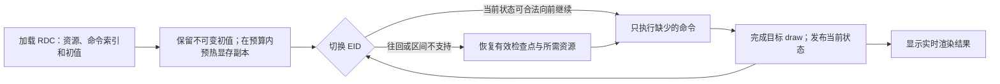

# EID 性能开发：独立 worktree 恢复验证（2026-09-08）

本轮在 `codex/eid-interactive-replay` / `D:\Study\GitHub\renderdocUltra-eid-perf`
继续开发。原工程只作为历史证据来源，不部署到原工程，不修改原始 RDC 或用户 Shader 项目。
本记录区分新改动、继承代码的新验证与尚未实现的路线。

后续验收优先级按用户最新要求聚焦 `1.rdc`：往回拖动、跨分段访问和固定 EID 参数更新。
`6.rdc` 留作后续回归，不作为推进 `1.rdc` 开发的前置条件。全平台架构目标不变。

## 已验证的主路线

不可变初值与工作资源是不同概念。初值可以一直保留，工作 RT、深度、UAV 和 buffer
会被回放命令改变；往回跳不能直接沿用较晚 EID 的工作内容。检查点需要资源内容和执行状态，
单独保存最终图像不足以继续执行。两套工作资源可以改善切换调度，但每套被修改后仍需正确恢复。

持久状态的具体复查：`restore-1-v2.16.timing.log` 显示 10535 检查点独立保存 183 项、
488,964,096 B 的资源，命中后仍有 3,467,411,402 B 的初值复制。保存路径位于
`d3d12_device.cpp` 的 `SaveReplayCheckpoint`，恢复路径 `RestoreReplayCheckpoint` 将副本复制回
可写资源。因此剩余工作不是重新创建同一份快照，而是消除不必要的工作资源复原。
分段应优先选择有明确清空/完整覆盖语义的边界：只读上游结果共享，完整覆盖的输出省去旧内容复制，
必须读取旧颜色/深度/UAV 的资源才恢复。是否能省略仍需完整访问范围和别名证明，不由用途列表缺项决定。

## 新增与完成的工作

- 建立本 worktree 的原生 core、system_load、Python binding、CLI、Python 宿主与 demo 构建。
  `RENDERDOC_CONFIG_DIR` 将 native 配置放在显式目录；默认平台配置入口不变。
  本地宿主使 native timing 日志也留在本 worktree。说明见 `util/perf/ISOLATED_REPLAY.md`。
- `D3D12DirtyRestore restoreTimingVersion=2`：按真实调用分别记录 CPU memcpy、GPU UPLOAD、
  DEFAULT、OTHER 的 buffer range 字节及 texture padded footprint；大小未知的 CopyResource
  只记次数。明细保留最大 24 项并记录省略量，总量可对账。关闭 timing 时不增加 heap 查询。
- `analyze_eid_restore.py` 区分旧 source extent 计数和真实复制计数；旧日志缺字段保持未知。
  inventory 可收集显式 `(checkpoint,target]` 窗口的用途观察，不声称这就是跳过恢复的证明。
- 完成继承的 D3D12 live-forward 实现的实际 GPU 正例和禁用对照。新 fixture 每帧先清空 RT，
  证明跳过中间 EID 后确实执行了中间 draw，避免上一帧残留图像造成假通过。
- demo 捕获只清理持有句柄并核对路径、PID、启动时间的自有 Windows 进程。

本轮没有重新部署 qrenderdoc，也没有把离线接口测量称为鼠标到屏幕延迟。

## 同一 v2 二进制的实测

Windows / NVIDIA GeForce RTX 3080 Ti；Development 使用 `ReplayOptimizeDevelopment=true`。
core SHA256：`B2C2E39A428E58EA4A53DEB9BC280B6BDBD690392F1457599CA974FE3E4A6329`。
每个 steady EID 4 次；p50 使用 nearest-rank。不同 RDC/EID 属于不同工作量，不是受控加速比。

| RDC / EID | 恢复检查点 | 回放接口 p50 | 从 UPLOAD 复制 | 从 DEFAULT 复制 |
|---|---:|---:|---:|---:|
| 1 / 24917 | 10535 | 185.588 ms | 2,957,901,643 B | 509,509,759 B |
| 1 / 29385 | 10535 | 178.417 ms | 2,685,690,997 B | 417,698,815 B |
| 6 / 5489 | 2070 | 41.739 ms | 4,069,416 B | 2,694,257,488 B |
| 6 / 12016 | 2070 | 77.016 ms | 2,980,688 B | 2,134,989,064 B |

这些是录制复制命令的范围/footprint 字节，不是 PCIe 硬件计数器，也不包含所有检查点复制。
`1 / 24917` 的 UPLOAD 中，637,694,404 B 来自 buffer range，2,320,207,239 B 来自 texture
footprint。差距与初值源是否已有显存副本高度相关；不能只根据 `initialUploadCacheFallbackBytes`
推断实际流量，更不能把所有延迟都算在资源恢复上。

两份 profile 均通过所有选定颜色/深度输出视图的原生像素与独立 force 回放比较。
inventory 完整读取 1.rdc 的 6,871 个纹理/buffer、181,230 条用途，以及 6.rdc 的 1,316 个资源、
22,282 条用途。用途覆盖仅指返回列表读取完整，不表示 RenderDoc 的绑定分析没有遗漏。

### 1.rdc 当前状态向前继续的 A/B

同一 capture、同一 v2 DLL、同一 EID 序列，只有 live-forward 开关不同；检查点在两组中均启用。

| 区间 | 禁用 p50 | 启用 p50 | 原生增量命中 |
|---|---:|---:|---:|
| 28745 → 28776 | 193.569 ms | 2.478 ms | 4/4 |
| 28827 → 29155 | 193.114 ms | 2.866 ms | 4/4 |
| 29155 → 28745（往回） | 193.630 ms | 190.548 ms | 0/4 |
| 28776 → 28827（非线性事件区间） | 193.556 ms | 190.715 ms | 0/4 |

命中日志同时证明 `initialRestoreSkipped=1`，中间 API 事件数分别为 30 和 327。
所有目标在两组中的 force 参考一致，普通访问也一致；实景覆盖当前绑定输出，未验证每个未绑定 UAV。
测试每次访问后读回像素，影响 GPU 排队，因此表格不等于连续拖动端到端延迟。

独立小 fixture 的四个 draw 为 47/51/55/59，检查点关闭。启用组有 4 个必需命中，
禁用组 0 个；8 张完整纹理在所有普通访问中与独立 force 参考一致。EID 51/55 的中间输出
在最终 EID 已不绑定，但确实由清空状态变成正确的新内容。

## 预热策略实验结果（v3）

`RENDERDOC_D3D12_INITIAL_SOURCE_CACHE_ORDER=first-write` 仅重排加载时的初值源预热候选副本，
按正向观察到的首次写入排序；同源聚合，placed resource 向所属 heap 汇总，未知源排后。
实际恢复集合、顺序、预算与 UPLOAD 回退保持不变。默认 `legacy`。
“早写”只是优先级假设，不保证是用户随后拖动的热点；是否保留或启用以同二进制 A/B 为准。

v3 core SHA256：`29629355095d35854cdad3d1ae937dbcf879bcefb33e6173d25474ccfaa86c5f`。
1.rdc 两种模式使用同一 DLL 和原始 capture，均从检查点 10535 恢复，每 EID 4 次 steady 访问：

| EID | legacy p50 | first-write p50 | 实际 UPLOAD 字节变化 | 实际总复制量 |
|---|---:|---:|---:|---:|
| 24917 | 186.205 ms | 147.351 ms | 2,957,901,643 → 1,967,028,057 B | 3,467,411,402 B 不变 |
| 29385 | 179.194 ms | 146.300 ms | 2,685,690,997 → 1,850,242,179 B | 3,103,389,812 B 不变 |

显存初值副本分配约从 2.105 GB 变成 2.119 GB，仍使用原有预算限制。每个 EID 在两模式中的
28 次访问均与跨运行的 force 参考一致。打开回放本次分别为 12.795 s / 12.094 s；各只有一次，
不据此声称改善加载性能。排序与计量新增测试加配置隔离测试共 96 assertions / 5 cases 通过。

6.rdc 的 first-write 对照 **未验收**。原工作区的 `q_render_soco_doc.exe`（PID 34192，
2026-09-08 10:41:12 启动）随后占用显存；该次测试的 DXGI budget 约 3.71 GB，而已有 replay
usage 约 4.15 GB，初值缓存和检查点都未能分配，checkpoint hits=0。像素比较通过，但所需
检查点命中验收失败，不能当作新策略性能回归或成功。该次记录完整保留，不结束另一工程的进程。
因此默认仍为 legacy，first-write 保留实验开关；待独占 GPU 后补跑 6.rdc 与 1.rdc 后段。
工具守卫补充重命名后的 GUI/CLI 名称，GPU 脚本使用 `-RequireIdleReplay` 预检。

## 后续开发与适用边界

1. **扩大合法增量范围。** D3D12 目前仍限制同一 primary submission 的可线性执行区间；
   往回、间接事件、跨提交及特殊隐藏状态需检查点或完整回放。不能只为了命中率放松校验。
2. **按分段依赖减少恢复。** 加载时建立实际读取/写入范围和别名关系，证明完整覆盖写之前没有读取，
   或维护“尚未恢复”的资源有效性。只略过 copy 然后清空全局 dirty 集合会造成后续错误。
   超大 descriptor range、bindless、sparse、alias 和 shader 编辑扩大访问范围时必须保守回退。
3. **缓存真正会复制的初值范围。** 如果显存预算主要浪费在只使用少量范围的巨大初值源，
   可对 CopyBufferRegion 分段保留显存副本；未知段回退原 UPLOAD，仍执行实际恢复。
   这与缓存 EID 截图无关，原始初值不会因用户编辑而改变。
4. **共享参数与失效传播。** 参数身份应是捕获内原始 buffer + 绑定起始偏移 + 变量/数组偏移 + 字节范围，
   用户覆盖值独立保存以便复原。更改输入字节很便宜，但它影响的下游 RT/UAV 仍需重算；只更新检查点中的
   CBuffer 而保留已受旧值影响的输出是不正确的。先用最早受影响的有效前缀渲染当前目标，再在空闲期更新依赖点。
5. **全平台继续状态协议。** 公共语义为普通目标成功完成后发布
   `(capture/mutation generation, EID, backend cursor)`；消费前失效，完成后再发布。
   force、分析、编辑、替换及错误都须使旧 cursor 失效。公共“图像有效”不能替代后端的“可继续执行”证明。

| 后端 | 已有基础 | 尚需实现/验证 |
|---|---|---|
| D3D12 | 检查点、限定区间 live-forward；本轮实际正例 | 扩大合法区间、往回恢复成本、实机 UI |
| D3D11 | 检查点、非零起点 partial replay | 普通 draw 后发布/消费 live cursor；deferred、Map、query 限制 |
| GL / GLES | 检查点、partial replay | context、query、conditional、transform feedback、共享 chunk 子 EID 边界 |
| Vulkan | 同 primary/pass 的检查点区间校验、partial command buffer | 复用区间校验跳过资源复制，正确发布 image states 与 ShaderFeedback 结束状态 |

本轮 Windows 实测不代表 Linux、Android、远程回放或上述其它后端已验收。
主路线已由真实增量回放的收益验证；尚未解决的问题集中在合法范围、反向恢复和跨后端状态正确性。

## 证据目录

本 worktree `output/eid-perf-20260908/`：

- `build-restore-profile-v2-receipt.json`、`verification-isolation.json`、`runtime-isolation.json`
- `restore-{1,6}-v2.json`、`restore-v2-with-inventory.{json,md}`
- `inventory-{1,6}-v2.json` 及 `.resources.json` / `.actions.json`
- `forward-fixture.json`、`forward-{on,off}-v2.json`
- `real-forward-{on,off}-v2.json`、`real-forward-comparison-v2.json`
- `warmup-1-{legacy,first}-v3.json`、`warmup-v3-final.{json,md}`、`warmup-v3-parity.json`
- `warmup-6-first-v3.json`（显存并发干扰，未验收；不得据此生成成功结论）
- `build-warmup-priority-v3-receipt.json`、`unit-warmup-priority-v3.log`、`runtime-isolation-v3.json`

最终原生新增路径 96 assertions / 5 cases 通过；Python attribution/inventory 18 项、
live-forward 证据 9 项、demo 归属 8 项通过。构建与运行失败记录保留，最终结论只引用成功收据。
