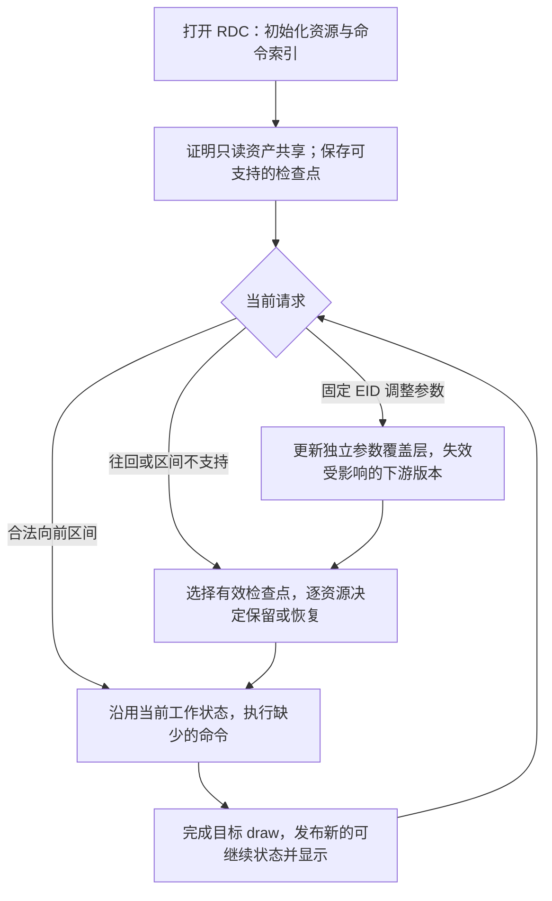

# EID 交互回放：资源版本、跨 API 增量与验收进度（2026-09-08）

本文记录独立 worktree `D:\Study\GitHub\renderdocUltra-eid-perf` 本轮的源码与证据状态，
补充 [此前的开发记录](Interactive-Replay-20260908.md)，不覆盖其历史测量。
**目前没有完成“大型 RDC 任意来回拖动均实时刷新”的最终目标。** 已验证可继续区间的真实增量回放，
并减少部分重复恢复；`1.rdc` 的反向/跨阶段恢复仍有主要成本。

记录截点包含 v7b、v8b、v9 和 v10 的实际验收，具体证据分别列于后文。
旧二进制通过不自动等于新二进制通过。
本轮回放与编辑作用于独立回放环境及替换层，原始 `.rdc`、捕获资产初值和原工作区的 Shader 项目
不会因为调节参数而被改写。

## 方案与当前完成边界

目标是保留可继续执行的资源状态，而不是用某个 EID 的截图代替渲染。捕获帧虽然固定，回放命令
仍会写入 RT、深度、UAV、计数器和部分 buffer；“文件静态”不等于“工作资源内容始终不变”。

| 内容 | 当前状态 | 适用边界 |
|---|---|---|
| 资源版本公共策略 | 已实现 | 表达原始资源 ID、子资源/字节范围、内容版本、编辑 generation、别名失效和待恢复债务；不自行执行 GPU 复制 |
| D3D12 检查点驻留版本复用 | 已接入并有 GPU 验证 | 当前工作版本与目标检查点版本相同才省略复制；无法证明时恢复 |
| D3D12 完整 Clear 前省略恢复 | 实验开关，小 fixture 已验证 | 有完整“先清空、后读取”证明的独立 committed 纹理；不支持任意 alias/sparse 阶段 |
| D3D12 descriptor overlay | 实验开关，正确性已验证 | 避免把检查点将覆盖的描述符槽先还原初始值再覆盖；不代表减少纹理/buffer 的 3.47 GB 初值复制 |
| D3D12 SM6.6 有限 UAV 声明裁剪 | v10 独立正例与主帧命中已验证，实验开关 | 完整原始执行程序证明，静态 buffer 正例每次省 8 MiB；主帧本轮无检查点条件仅省一小部分恢复量 |
| D3D11 / GL / GLES / Vulkan 普通 EID 向前继续 | 显式开启/关闭与共享参数测试已验证 | 各 API 的严格安全区间；不是任意命令序列或跨提交继续 |
| 跨 API live-forward 默认开启 | v8b 四 API 默认模式已验证 | 环境变量为 `0` 仍关闭；实际移除开启变量后验证，不能用显式 `1` 代替默认配置验收 |
| GL 静态资产共享 | 已有原生实现 | 需要捕获完整写入来源证明；不是根据 GetUsage 没返回某项就判定只读 |
| 历史 fallback 保持显示身份 | v7b 负例与 v8b 修复正例成对验证 | headless D3D11/GL/Windows GLES/Vulkan 路径通过；实际窗口与 Qt 面板仍需回归 |
| 固定 EID 共享参数覆盖与空闲维护 | 已有基础实现，本轮继续验证普通增量中的共享参数 | 原始 buffer 与绝对字节范围定位；前台前缀重绘、空闲限额维护已存在，更细粒度阶段依赖仍待实现 |
| 大型 RDC 按深度/GBuffer 等阶段建立更多有效检查点 | **尚未完成** | 尤其后续阶段包含 alias/placed/sparse 写入时的内容与环境保存、恢复仍未实现 |
| 两套可轮换的阶段工作资源 | **尚未实现** | 不能把现有检查点缓存、空闲维护或公共版本表称为这个功能 |

公共策略见 [replay_resource_versions.h](../../renderdoc/replay/replay_resource_versions.h) 和
[实现与测试](../../renderdoc/replay/replay_resource_versions.cpp)。它区分四种操作：
版本相同则保留；缺失/未知则恢复；完整覆盖之前可延迟恢复；编辑使目标旧版本失效则重建前缀。
待恢复项必须由真实复制或完整覆盖完成后清除，不能在一次回放结束时无条件清空。
别名关系未完整证明时，相关存储必须一起失效或走原有恢复路径。

建议继续采用的流程为：



该流程中的“更多阶段检查点”仍需要后端实现。两个工作环境可以减少切换时的准备，但各自被写过的
内容仍需验证或恢复；增加第二套资源并不能自动消除旧参数产生的下游 RT。

## `1.rdc`：已经省了什么，仍然慢在哪里

### 驻留版本省掉约 480 MB 的检查点复制

v5 的 EID 24917 恢复检查点 10535 时，检查点有 183 项资源，快照数据量 488,964,096 B。
原生日志给出 `residentCopiesSkipped=178`、`residentAllocationBytesSkipped=480378880`，
即 178/183 项已经是目标版本，约 480 MB 无须再从检查点复制。EID 29385 的首次记录为
179 项、480,444,416 B；不能把不同目标的计数混作同一测量。

这是已经接入的真实恢复优化，但省掉的是**检查点副本到工作资源**这部分。
另外的初值恢复仍记录 3,467,411,402 B，不能将两者相减后声称原来的 3.47 GB 已消除。
日志字节是原生分配/复制范围计量，不是 PCIe 硬件带宽计数器。
证据：[v5 原生日志](../../output/eid-perf-20260908/resident-1-on-v5.native.log)、
[开启验收](../../output/eid-perf-20260908/resident-1-on-v5.json)、
[同版本对照](../../output/eid-perf-20260908/resident-v5-comparison.md)。

### v7b 整体仍约 187 ms，初值复制量没有变

同一 v7b 二进制、同一 capture、每个 EID 4 次 steady 访问，p50 用 nearest-rank：

| 目标 EID | 恢复检查点 | 实验组合关闭 p50 | descriptor overlay + full-clear 开启 p50 | 初值复制/次 |
|---|---:|---:|---:|---:|
| 24917 | 10535 | 187.052 ms | 186.928 ms | 3,467,411,402 B，未变 |
| 29385 | 10535 | 179.841 ms | 181.109 ms | 3,103,389,812 B，未变 |

开启组内的典型 `descriptors_ms` 为 0.459 ms，关闭组为 19.355 ms；同时描述符改写量从
53,341 项降为 0。**这是局部阶段的约 19 ms → 0.4 ms，不是整体接口省了约 19 ms。**
表中整体没有体现相应收益，不能将嵌套计时相加，也不能仅凭该阶段数字给出加速结论。
该组 `1.rdc` 日志的 `fullClearInitialCopiesDeferred=0`，没有获得完整 Clear 的跳过收益。

开启、关闭、故意拒绝检查点、禁用检查点初值源四组的完整绑定输出及 pipeline witness，均与
两次独立强制回放参考一致。覆盖范围不是所有未绑定 UAV，也不是鼠标到屏幕的端到端延迟。
证据：[开启](../../output/eid-perf-20260908/clear-overlay-1-on-v7b.json)、
[关闭](../../output/eid-perf-20260908/clear-overlay-1-off-v7b.json)、
[计时对照](../../output/eid-perf-20260908/clear-overlay-v7b-comparison.md)、
[四组交叉参考](../../output/eid-perf-20260908/clear-overlay-v7b-cross-reference.json)、
[开启原生日志](../../output/eid-perf-20260908/clear-overlay-1-on-v7b.native.log)、
[关闭原生日志](../../output/eid-perf-20260908/clear-overlay-1-off-v7b.native.log)。

3.47 GB 之所以仍大，是因为恢复候选尚含大量潜在写入资源，后续 alias 阶段又无法建立有效的新起点。
UAV 表可绑定的范围通常大于着色器实际使用范围；表中的普通纹理也可能因此被保守纳入。
目前有 256 MB 的纹理数组、多个约 236 MB 的 3D RT 等大项，不能一概解释成网格重复上传。
下一步应减少有证据可排除的候选和建立后续阶段状态，不能直接按“看起来像材质纹理”跳过。

UAV 声明范围裁剪目前为实验源码，开关为 `RENDERDOC_D3D12_ENABLE_UAV_DECLARATION_RANGES=1`。
v8b 已改为取**原始可执行** SHEX/SHDR/DXIL 中的完整声明，并保留数组、space 和阶段可见性；
外部调试文件或 ILDB 不能单独构成少写证明。原始完整根签名范围仍须保留，供替换着色器、
无界/直接 heap 访问及证明不完整时回退。v8b 单元测试覆盖原始程序选择与不一致调试数据，
本记录不提前赋予这条新路径 `1.rdc` 的 v8b 性能或像素验收结论。
代码入口：[d3d12_commands.cpp](../../renderdoc/driver/d3d12/d3d12_commands.cpp)。

### 完整 Clear fixture 已证明真实跳过 524,288 B

专门的 `D3D12_Checkpoint_Triangle` capture 中，检查点 17 → 目标 48 和检查点 33 → 目标 64
的日志记录 `fullClearInitialCopiesDeferred=1`、`fullClearAllocationBytes=524288`，
即一项 512 KiB 资源的恢复被省略，随后由已证明的完整 Clear 建立正确内容。
它不是只有计划字段：原生恢复路径出现该跳过计数，后续输出与强制参考像素一致，整份报告 `ok=true`。
报告还覆盖重新配置、禁用/重新启用及小预算路径。
证据：[fixture 验收](../../output/eid-perf-20260908/clear-fixture-on-v7b.json)、
[原生日志](../../output/eid-perf-20260908/clear-fixture-on-v7b.native.log)、
[fixture 事件发现](../../output/eid-perf-20260908/clear-fixture-v8.json)。

该结果仅证明受限拓扑可行，不能外推为 `1.rdc` 已省掉恢复。延迟恢复必须同时维护内容债务、失败回退、
后续检查点保存和资源读取；Discard、GetUsage 没有记录或局部覆盖都不能代替完整 Clear 证明。
开关保持 `RENDERDOC_D3D12_CHECKPOINT_FULL_CLEAR_PREFIX=1`；descriptor overlay 另由
`RENDERDOC_D3D12_ENABLE_CHECKPOINT_DESCRIPTOR_OVERLAY=1` 控制。
实现见 [d3d12_device.cpp](../../renderdoc/driver/d3d12/d3d12_device.cpp) 与
[描述符恢复](../../renderdoc/driver/d3d12/d3d12_resources.cpp)。

## 跨 API 向前继续与共享参数：已完成的实际验收

普通向前继续协议已进入 D3D11、GL/GLES、Vulkan 的原生回放路径：只有普通目标 draw 成功后
发布 cursor；使用前先失效，只有完成后才能发布新 cursor。强制参考、分析、编辑、错误及不支持的
隐藏状态会使旧 cursor 失效或强制回退。D3D11 对含 Map 等区间仍保守拒绝，Vulkan 仍受同一
primary/pass/submission 等资格限制。D3D12 的实景与独立 fixture 增量正例见此前开发记录。

以下都是 **Windows / NVIDIA GeForce RTX 3080 Ti 单 GPU** 的离线回放验收。
OpenGLES capture 是 Windows 上的 GLES 路径，**不是 Android 设备验收**；不包含 Linux、
移动 GPU、远程回放或多 GPU。各 API 使用自己的实际 EID，不能把不同 fixture 的耗时作横向加速比。

| API / 二进制 | 四个 draw EID（A/B/C/D） | 开启命中区间及总数 | 关闭命中数 | 共享参数 V1 / V2 / 撤销阶段命中数 |
|---|---|---|---:|---|
| D3D11 / v6 | 13 / 17 / 22 / 26 | AB、CD：2 | 0 | 2 / 2 / 2 |
| OpenGL / v7b | 10 / 17 / 22 / 29 | AB、BD、AC、CD：4 | 0 | 5 / 5 / 4 |
| OpenGLES / v7b | 10 / 17 / 22 / 29 | AB、BD、AC、CD：4 | 0 | 5 / 5 / 4 |
| Vulkan / v7b | 17 / 20 / 23 / 26 | AB、BD、AC、CD：4 | 0 | 5 / 5 / 4 |

普通序列为 A→B→D→A→C→D；共享编辑阶段另含编辑后的 BD 访问，所以阶段计数可达 5，
不是同一个四区间分母。所有列出的报告 `ok=true`，缺少原生正命中的 fallback-only 运行不能通过。
GL/Vulkan v6 的零命中失败记录保留，不作为成功证据。

验收读取四个事件出现过的固定输出集合，包含后来未绑定的输出与其子资源，并与每个 EID 两次
独立强制回放逐字节/hash 比较。B/C 的视口中心像素必须在本次 draw 改变并保留到 D，以排除
“中间 draw 被漏掉但上一帧残留让结果看似相同”的假通过。读回会同步 GPU，以上不是 UI 帧率保证。

| API | 开启证据 | 关闭证据 | 共享编辑证据 |
|---|---|---|---|
| D3D11 | [on v6](../../output/eid-perf-20260908/portable-d3d11-on-v6.json) | [off v6](../../output/eid-perf-20260908/portable-d3d11-off-v6.json) | [edit v6](../../output/eid-perf-20260908/portable-d3d11-edit-v6.json) |
| OpenGL | [on v7b](../../output/eid-perf-20260908/portable-gl-on-v7b.json) | [off v7b](../../output/eid-perf-20260908/portable-gl-off-v7b.json) | [edit v7b](../../output/eid-perf-20260908/portable-gl-edit-v7b.json) |
| OpenGLES | [on v7b](../../output/eid-perf-20260908/portable-gles-on-v7b.json) | [off v7b](../../output/eid-perf-20260908/portable-gles-off-v7b.json) | [edit v7b](../../output/eid-perf-20260908/portable-gles-edit-v7b.json) |
| Vulkan | [on v7b](../../output/eid-perf-20260908/portable-vulkan-on-v7b.json) | [off v7b](../../output/eid-perf-20260908/portable-vulkan-off-v7b.json) | [edit v7b](../../output/eid-perf-20260908/portable-vulkan-edit-v7b.json) |

参数身份是**原始 buffer ID + 绑定起始偏移 + 变量/数组偏移 + 字节长度**。同一大 buffer 的
不同区间不能被误并成同一个参数。测试在固定 B 先后提交两个 16 字节值，提交后不切换 EID 即读取
结果，随后核对四个共享 draw、邻接字节窗口和强制参考，撤销后恢复原始效果。
覆盖层改变回放内存，不改写 capture 中的资产初值。输入字节变化虽小，其影响的下游 RT/UAV
仍需重新渲染；当前没有“只写 CBuffer 就自动修复所有既存阶段输出”的实现。

上述共享参数报告的 `shaderAcceptance` 均为 `notRequestedNotTested`，不能据此声称着色器替换
已经完成同等 GPU 验收。D3D11 checked shader replacement 在本 worktree 尚缺原生实现，
需要与独立 Shader ABI 工作衔接；不得为了测通而绕过 ABI 检查使用未校验替换。

默认开启源码已改为 D3D11/GL/Vulkan 对应 `ENABLE_LIVE_FORWARD` 环境变量不等于 `0` 即启用，
但原生资格校验仍执行。新 [portable 验收脚本](../../util/perf/eid_portable_forward_profile.py) 的
`--default-live-forward` 会主动移除三个环境变量，记录 `environment=null` 对应项及
`environmentPresence=false`，并要求 `--expect-hit-ranges`。原无参数模式仍显式设置 `1`；
`--disable-live-forward` 显式设置 `0`。这三个模式需要不同进程。
v8b 已另行完成四 API 默认配置验收；四份报告均 `measurementComplete=true`、`ok=true`，
三个开启变量的实际 `environmentPresence` 都为 `false`，同时完整输出和两次强制参考一致：

| API | 默认配置原生命中数 | v8b 独立证据 |
|---|---:|---|
| D3D11 | 2（AB、CD） | [default v8b](../../output/eid-perf-20260908/portable-d3d11-default-v8b.json) |
| OpenGL | 4（AB、BD、AC、CD） | [default v8b](../../output/eid-perf-20260908/portable-gl-default-v8b.json) |
| OpenGLES | 4（AB、BD、AC、CD） | [default v8b](../../output/eid-perf-20260908/portable-gles-default-v8b.json) |
| Vulkan | 4（AB、BD、AC、CD） | [default v8b](../../output/eid-perf-20260908/portable-vulkan-default-v8b.json) |

这是本机、本 fixture 的默认配置证据；关闭及共享编辑的版本仍以此前矩阵标出的 v6/v7b 为准。

## 历史显示：负例与修复正例已成对验证

[v7b 负例](../../output/eid-perf-20260908/history-fallback-d3d11-before-v7b.json)
在 headless 输出选历史 B、控制器停 D 后，执行 `SetFrameEvent(D,true)` 再 `Display()`，
确实出现历史 fallback 重绘证据缺失、完整 RGB 不等于 B 强制参考。固定 D 的参数修改/撤销也
触发相同问题。该失败用于证明回归测试能发现原缺陷，不能算为通过。

新源码在 [replay_output.cpp](../../renderdoc/replay/replay_output.cpp) 中保留历史显示的
EID、显示配置、编辑 generation 和画布尺寸。普通刷新、尺寸或编辑变化会重绘该历史 EID，
然后恢复控制器当前 EID；显式 `SetTextureDisplay` 清除历史身份并回到实时输出。
保留的是重绘来源，不增加一份历史截图。像素上下文走相同来源，绘制前清除递归入口；致命错误时
清理该身份。原有可用快照路径仍存在，不能说本轮取消了所有历史缓存。

[headless 回归脚本](../../util/perf/eid_history_fallback_profile.py) 检查完整显示 RGB、
两次独立参考、控制器仍为 D、dirty 后仍为 B、显式退出后为 D，以及可选共享参数修改/撤销。
它用强制 EID 刷新制造 dirty，不声称覆盖实际原生窗口 resize、Qt 标签切换和鼠标拖动。
后续 [v8b 修复正例](../../output/eid-perf-20260908/history-fallback-d3d11-v8b.json)
已实际 GPU 通过，`verdict=passedPersistentHistoricalFallback`、`issues=[]`。
覆盖强制 D 后的 dirty 刷新、固定 EID 共享参数更新、撤销，以及显式退出历史回到 D；
与 v7b 失败结果组成同一测试的修复前后证据。
[OpenGL](../../output/eid-perf-20260908/history-fallback-gl-v8b.json)、
[Windows GLES](../../output/eid-perf-20260908/history-fallback-gles-v8b.json) 和
[Vulkan](../../output/eid-perf-20260908/history-fallback-vulkan-v8b.json) 也通过相同的历史来源、
共享参数修改及撤销验收。**原生窗口和 Qt 面板端到端仍需验收；Windows GLES 不代表 Android 设备验收。**

## v9：扩大证明范围后的实际结果

在不改变检查点与查询恢复资格的前提下，纹理内容读取扫描允许 `BeginQuery` / `EndQuery`
经过；`ResolveQueryData` 仍不按无写入操作处理。增加“查询结束后完整清屏”的 GPU 测试帧：
[v8b 对照](../../output/eid-perf-20260908/clear-query-before-v8b.json) 像素一致但实际省略次数为 0，
因未命中优化而拒绝；[v9 正例](../../output/eid-perf-20260908/clear-query-after-v9.json)
通过 8 次实际完整清屏恢复省略，并通过临时原生着色器替换/撤销后的检查点重建与像素检查。
此项使用测试用 `BuildTargetShader` / `ReplaceResource`，不代表 Shader Workbench 的 ABI 验收，
该 D3D12 测试帧也没有运行 CBuffer 修改。

UAV 声明裁剪也允许已知、单个末尾 Draw/Dispatch 的 `ExecuteIndirect` 签名：此类命令不改变
PSO、根签名、描述符表或 Root UAV。未知命令、间接 Root UAV 和射线命令继续回退。
不过 `1.rdc` 使用的原始 SM6.6 程序还不在 v9 的证明范围，实际声明裁剪为 0。
[v9 开关对照](../../output/eid-perf-20260908/declared-uav-v9-comparison.md) 显示：

| EID | 关闭声明裁剪 p50 | 开启声明裁剪 p50 | 初始复制量是否下降 |
|---|---:|---:|---|
| 24917 | 188.553 ms | 189.946 ms | 否，仍约 3.47 GB |
| 29385 | 182.577 ms | 183.348 ms | 否，仍约 3.10 GB |

两组均通过 11 次检查点恢复与输出参考比较，但不构成性能提升。内容扫描进一步走到 10544 的
alias/split barrier 后停止，5 个候选仍无获准省略。这明确区分了独立测试帧已经执行的优化和主场景
仍未覆盖的情况。下一步的 SM6.6 支持必须依据原始 executable 的资源元数据和 handle 来源，不能
根据调试反射或一次观察到的数组下标推断所有访问。

## v10：SM6.6 静态 buffer 恢复省略已实测

SM6.6 VS/PS/CS 的有限根绑定现在使用原始 DXIL 的完整声明和真实 handle 来源证明。
只支持已知 `createHandleFromBinding` / `annotateHandle` 链，动态索引保留整个声明数组；
直接堆寻址、未知 handle、元数据错配、未知解析记录及截断字节流继续回退。新增的解析完整性
标志只作为此优化的拒绝条件，不改变普通着色器执行语义。声明裁剪仍需实验开关显式启用。

[D3D12_UAV_Declarations](../../util/test/demos/d3d12/d3d12_uav_declarations.cpp) 把两个可写 buffer
和两个 4 MiB 静态 buffer 放进同一个 4 项 UAV 表。像素着色器动态访问前两个 UAV，静态资源
通过 SRV 参与最终像素。固定四个 draw 的 EID 为 25、50、75、101。
[关闭对照](../../output/eid-perf-20260908/uav-fixture-off-v10.json) 和
[开启正例](../../output/eid-perf-20260908/uav-fixture-on-v10.json) 使用同一 capture、DLL、pyd；
关闭检查点、prepared replay 和 live-forward。五次普通往返导航均有以下真实原生结果：

| 项目 | 关闭声明裁剪 | 开启声明裁剪 |
|---|---:|---:|
| 已录制初始恢复复制字节 | 8,781,824 | 393,216 |
| 脏资源数 | 5 | 3 |
| Static2 的复制字节 | 4,194,304 | 0 |
| Static3 的复制字节 | 4,194,304 | 0 |

每次实际少录制 8 MiB `CopyBufferRegion`，不是资源尺寸估算。完整四 buffer 和 RGBA8 输出都与
两次强制参考逐字节一致，两组 35,127,296 字节的参考文件也完全相等。12 条声明裁剪记录是
6 次访问分别产生的 `WithoutDraw` / `OnlyDraw` 记录，不能解释成 12 次资源恢复节省；初次 seed
仍完整恢复。小测试的切换耗时未明显下降，因此这里只证明复制省略与正确性。

测试设备的系统运行库报告 SM6.5；测试目录单独加入微软签名有效的
[Agility SDK 1.614.0](https://www.nuget.org/packages/Microsoft.Direct3D.D3D12/1.614.0) 后，
实际设备查询返回 SM6.6 并成功捕获。DLL 仅位于本 worktree 的 `util/test/D3D12`，
[依赖收据](../../output/eid-perf-20260908/tools/agility-1.614.0/receipt.json) 保留下载来源、版本、
SHA256 和签名结果；未修改系统或主分支运行库。

### 与主分支并行运行 `1.rdc` 的限制

按用户要求，主分支 GUI 保持运行，隔离 runner 的 `-AllowForeignGui` 先确认其加载模块不属于
本 worktree，再允许独立测试；配置、日志、程序、输出路径与进程清理仍隔离。
[进程收据](../../output/eid-perf-20260908/replay-idle-declared-uav-1-on-v10.json) 明确记录同卡
GPU 条件。这不是独占显卡性能测量。

[主帧 v10 开关对照](../../output/eid-perf-20260908/declared-uav-v10-comparison.md) 的两组运行均
报告 `Insufficient GPU memory headroom for checkpoints`，检查点构建和命中均为 0，故两份
报告均正确保留 `ok=false`。两组各 14 项输出比较通过，
[跨运行参考](../../output/eid-perf-20260908/declared-uav-v10-cross-reference.json) 也一致。
在同样没有检查点的普通切换中：

| EID | 关闭时实际复制字节 | 开启时实际复制字节 | 少复制字节 |
|---|---:|---:|---:|
| 24917 | 3,955,498,234 | 3,838,329,466 | 117,168,768 |
| 29385 | 3,591,476,644 | 3,556,383,656 | 35,092,988 |

主帧确有声明裁剪命中，但没有通过检查点速度验收；也不能将此轮复制量或约 380–460 ms 的
共享 GPU 耗时与 v9 的检查点命中结果直接相比。这个小比例的省略进一步说明，剩余阶段恢复
范围和 alias 存储的处理仍是主问题。

## v11：无关别名屏障之后的完整清屏

对已经证明为独立 committed 存储的纹理，内容扫描现在允许穿过普通 alias barrier，继续寻找
完整清屏。它没有允许保存可写 alias 存储，也没有改变实际屏障执行。清屏前读取旧内容、split
barrier、未知屏障以及不在预先批准集合中的资源仍然拒绝省略。

三份同版本 GPU 验收分别覆盖：

- [完整清屏](../../output/eid-perf-20260908/alias-clear-verdict-v11b.json)：52 次纹理见证，
  17 条实际 restore 记录，其中 3 次普通恢复省略了清屏前的旧内容复制。
- [先读取后清屏](../../output/eid-perf-20260908/alias-read-verdict-v11b.json)：52 次见证，
  17 条 restore，省略为 0；见证纹理确实保留上一段完整输出。
- [混合 split barrier](../../output/eid-perf-20260908/alias-split-verdict-v11b.json)：52 次见证，
  17 条 restore，省略为 0。

两张 256×128 RGBA8 纹理的完整原生字节哈希，在所有对应普通访问与两次独立强制参考中一致。
原生 Shader 替换与复原也通过；这不是 Shader Workbench ABI 或 D3D12 CBuffer 编辑验收。
[关闭开关、启用及注入恢复失败的跨运行参考](../../output/eid-perf-20260908/alias-clear-cross-reference-v11.json)
使用同一捕获和二进制，四个 EID 的双强制参考均一致。注入失败时检查点命中为 0，正常回退仍通过。

最初自动限制 2 个检查点的正例只实际省略 1 次，未达到要求，失败报告保留；后续显式上限为 4，
避免所需早期检查点被 LRU 淘汰。这是测试条件修正，不能把之前的失败改写为通过。

## `1.rdc` 剩余复制量的资源归因

v10 开关两组的前八项实际恢复量均为 **1,286,602,752 字节（1227 MiB）**，其中：

| 资源 | 单项恢复量 | 已核实的原因/限制 |
|---|---:|---|
| 17366069 | 256 MiB | reserved 稀疏纹理，16 个 backing heap；当前初值恢复预先标脏完整组件，即使此前未写也会恢复 |
| 18993341、18993351 | 各 225 MiB | 3D 纹理，10566/10567 的 Discard 在回放中实际填充内容，不是纯状态记录 |
| 18993368 | 225 MiB | 与 18993341 使用同一 heap 偏移，不能作为独立静态纹理跳过 |
| 17368929 | 112 MiB | 10803/10810 的 CS 间接调度实际可能写入，是上游计算结果 |
| 18992991、18992992 | 各 64 MiB | 共用 placed heap；后者在 10546 被 Discard，前者还受到按整 heap 保守判断的影响 |
| 17368930 | 56 MiB | 10775/10795 的 CS 间接调度可能写入，后续确实读取 |

证据在 [实际复制日志](../../output/eid-perf-20260908/declared-uav-1-on-v10.12.timing.log) 和
[完整资源用法目录](../../output/eid-perf-20260908/inventory-1-v2.resources.json)。这里没有通过
GetUsage 缺项推断静态。所有条目的 CPU memcpy 为 0，表示此处从 GPU 可访问初值源复制，
不能据此断言捕获帧没有 CPU 更新。

后续可以保留已经建立且未再改变的完整稀疏初始组件；placed 资源则还要处理初值恢复自身的
重叠写入闭包。仅按“目标与本段脏区间不重叠”跳过仍可能被另一资源的恢复覆盖，不能直接放宽。

## v12b：独立 GUI 与真实控件验收

性能分支现在构建自己的 `x64/Development/q_render_soco_doc.exe`，并使用全新私有配置、
临时文件、ReplayLab IPC 和扩展目录。启动器核验自己的 DLL/Qt/Python 和固定 bridge，
不覆盖主工程输出，不复制个人配置，不关闭另一分支 GUI。主分支 PID 37160 在本轮始终运行。

[无捕获隔离探针](../../output/gui-isolation/probe-v12b/ui-result.json) 验证实际配置路径、
Python user-site、Python/Qt 临时路径、扩展及已加载模块；[真实界面验收](../../output/gui-isolation/presentation-v12b/ui-result.json)
在本分支 GUI 内发送实际 Qt 控件鼠标事件，完成 10 项检查、11 条控件输入路径和 48 次完整
现有输出图像读取：默认 RT0 在 held scrub 期间发布；历史单击预览保持全局 EID、双击跳转；
当前/历史标签往返及快速取消旧请求；返回当前页后 held 切换与松手画面一致。
两次运行都自行关闭测试实例，runner 记录的原用户配置前后哈希一致。

首轮 [presentation-v12](../../output/gui-isolation/presentation-v12/ui-result.json) 失败，原因是
测试计时器在 `LoadCapture` 嵌套事件循环中提前开始，随后正常加载收尾把选择恢复到末尾 EID。
脚本改为等待该调用真正返回后重测；没有把失败改写为通过，也没有为了此测试修改产品选择逻辑。

这些是小型 D3D12 捕获的 Qt 功能验收，不是 OS 鼠标/屏幕扫描输出、RT1 跨绑定记忆、
`1.rdc` 实时性能或所有平台的 GUI 验收。报告中的每阶段时长包含测试主动等待画面稳定和
读取图像的开销，不能当成输入延迟。此轮明确关闭内部服务验收，未打包的 Shader/Agent sidecar
不能据此标记可用；GUI/bridge 隔离和服务功能是不同的验收范围。

[v12b 构建](../../output/eid-perf-20260908/build-resource-versions-v12b-receipt.json)、
[原生运行身份](../../output/eid-perf-20260908/runtime-isolation-v12b.json) 和
[1,043 assertions / 56 cases](../../output/eid-perf-20260908/unit-resource-versions-v12b.log) 均通过。
新增稀疏初值驻留实验仍默认关闭，只允许单 reserved 纹理、无 placed alias 的完整组件；
真实复制提交成功才发布可复用初值，写入/映射/编辑/失败取消它。中间批次 Close 和复用列表 Reset
失败也显式取消证明，避免错误发布部分初值。是否在主帧产生收益必须另附实际 retain 和复制下降证据。

## v13：稀疏初值驻留的实际收益与失效验收

v12b 的主帧试验没有实际复用，原因是资格判断只接受 `{~0U}` 哨兵；捕获代码对非 MSAA
稀疏纹理保留显式子资源列表。v13 改为核对真实 mip、数组和 plane 总数，要求列表按序完整覆盖
`0..n-1`，仍拒绝缺项、重复、乱序和未知格式/plane。主帧的列表恰为 `[0, 1]`。

[主帧同版本开关对照](../../output/eid-perf-20260908/sparse-main1-comparison-v13.json) 通过：
两组各 10 次输出比较、每个 EID 两次独立强制参考及跨进程完整见证均一致。开启组记录 13 次
真实 `retain`；稳态两次往返中每次省略 268,435,456 字节，正好对应资源 17366069。

| EID | 关闭时实际恢复字节 | 开启时实际恢复字节 | 每次减少 |
|---|---:|---:|---:|
| 24917 | 3,838,329,466 | 3,569,894,010 | 256 MiB |
| 29385 | 3,556,383,656 | 3,287,948,200 | 256 MiB |

此对照刻意使用 1 MiB 检查点预算、两组命中均为 0，隔离“未变化的稀疏初值”这一项。
主 GUI 同时运行，共享 GPU 下观测到的稳态中位数分别为 698.75→665.20 ms、
710.66→694.35 ms；这些数据不构成独占 GPU 的速度验收，也不能和此前命中检查点的约 190 ms
直接比较。该优化没有增加这张纹理的另一份 GPU 备份，只保留尚未被改变的现有内容及映射。

专用 [关闭控制](../../output/eid-perf-20260908/sparse-fixture-off-v13b.json) 和
[开启验收](../../output/eid-perf-20260908/sparse-fixture-on-v13b.json) 也通过。六个目标的两次
独立强制参考、九次普通访问以及跨运行保存的原始数据逐字节一致：每次比较完整 128×128
稀疏纹理与 768×128 输出，共 458,752 字节。排除首次建立初值后，六次正例均实际少复制
65,536 字节；写入新内容后返回、改变物理映射后返回两次负例均重新复制并发布有效初值，
随后又能复用。没有通过忽略画面、只比较局部像素或仅看“批准候选”来判定成功。

这份脚本首次冷启动因为底层仍处于 Loading 而缺少 Active 专用日志，原报告保留为失败；
后续把冷启动单独列出并排除，然后仍要求完整的两次参考和实际优化证据。该实验继续默认关闭，
尚未把每种 Shader/共享 CBuffer 编辑与所有稀疏/placed 别名组合完成 GPU 验收。

[v13 构建](../../output/eid-perf-20260908/build-resource-versions-v13-receipt.json)、
[运行身份](../../output/eid-perf-20260908/runtime-isolation-v13.json)、
[1,055 assertions / 57 cases](../../output/eid-perf-20260908/unit-resource-versions-v13.log)、
[同版本 GUI](../../output/gui-isolation/presentation-v13/ui-result.json) 全部通过。
GUI 隔离改动已独立提交为 `1510e633a`，仍未合并或部署到原工程。

## 为什么投入较久，后续应集中在哪里

目前的收益证明“保留正确的工作状态并增量执行”方向可行；没有证明“多存几个现有检查点”就能解决
`1.rdc`。现有可保存点停留在 10535，后续大量候选因不支持的可写存储被拒绝。最重要的缺口是
**后续 alias 阶段检查点**，公共版本类、候选分段和 480 MB 驻留复用都不能代替它。

耗时主要花在把“可以跳过”的想法变成不会漏写的证明：真实提交发生前后绑定可以变，数组可以动态
索引，多个资源可别名到同一内存，编辑会改变后续依赖；某些回放还包含 query、隐藏状态和间接命令。
此外，新增测试曾真实拒绝零命中的 GL/Vulkan 路径，也复现了历史画面错误。保留这些失败证据，
可以防止把“图像看着没坏”误作优化已经执行。

下一步按以下顺序推进：

1. 以已完成的 v8b 构建、历史正例与四 API 默认模式为基础，补同版本禁用及共享编辑回归，保持
   原生命中、输出一致和失败回退门槛。验证 qrenderdoc 中真实标签切换、RT 选择保持和拖动刷新，
   记录输入到显示延迟。
2. 在 `1.rdc` 验证原始可执行 UAV 声明裁剪，确认实际减少 dirty/复制范围，并覆盖描述符变动、
   替换着色器扩大访问、无界访问的回退；只有整体接口数据改善才能计为解决用户卡顿。
3. 实现 alias 存储组件的阶段检查点：记录 backing heap/页映射、激活资源、布局/状态、内容版本、
   query/执行环境以及实际可恢复范围。先选择一个明确的后续深度或 GBuffer 边界，在 A→B→A、
   跨检查点和受控编辑后验证完整状态；不能用 GetUsage 缺项判断某段无须恢复。
4. 基于真实依赖图维护检查点失效：固定 EID 参数滑动优先完成当前输出，从最早受影响的有效前缀
   重算；结束调节后再限额后台重建下游检查点。只读资产继续共享，受影响输出必须更新。
5. 将经过验证的阶段能力接入各 API 的原生资源与执行环境，不另外实现一套通用 GPU 回放器。
   Windows 各 API 测试之外，再补 Linux、Android/GLES、其他厂商及远程环境。

因此本轮状态是“增量执行和局部恢复优化已成立，主场景的后续阶段恢复仍未解决”，不能标记全部开发完成。

## 测试与复现入口

- [v7b 原生单元测试](../../output/eid-perf-20260908/unit-resource-versions-v7b.log)：
  641 assertions / 36 cases 通过，过滤组含资源版本、Clear 前缀、写入阶段、live-forward 和描述符恢复。
  这份收据只对应 v7b，当时尚未包含全部后续 v8b 修改。
- [v8b 原生单元测试](../../output/eid-perf-20260908/unit-resource-versions-v8b.log)：
  813 assertions / 46 cases 通过，新增覆盖原始 executable UAV 声明、GL 异常恢复 RAII 和历史显示身份。
- [v9 原生单元测试](../../output/eid-perf-20260908/unit-resource-versions-v9.log)：
  885 assertions / 48 cases 通过，另有 [v9 构建收据](../../output/eid-perf-20260908/build-resource-versions-v9-receipt.json)
  和 [v9 运行隔离](../../output/eid-perf-20260908/runtime-isolation-v9.json)。
- v10 的 [原有过滤组](../../output/eid-perf-20260908/unit-resource-versions-v10.log) 907 assertions / 49 cases，
  [DXIL root-bindings](../../output/eid-perf-20260908/unit-dxil-root-v10.log) 61 assertions / 3 cases 均通过；
  [v10 构建收据](../../output/eid-perf-20260908/build-resource-versions-v10-receipt.json)、
  [运行隔离](../../output/eid-perf-20260908/runtime-isolation-v10.json) 和
  [UAV 验收脚本的 16 项纯测试](../../output/eid-perf-20260908/python-uav-v10.log) 也通过。
- [v11 原生测试](../../output/eid-perf-20260908/unit-resource-versions-v11.log)：997 assertions / 53 cases；
  [构建](../../output/eid-perf-20260908/build-resource-versions-v11-receipt.json)、
  [运行隔离](../../output/eid-perf-20260908/runtime-isolation-v11.json) 均通过。
  alias 发现脚本 7 项、独立报告验收器 9 项纯测试通过。
- [portable 纯测试](../../util/perf/test_eid_portable_forward_profile.py)：默认配置模式加入后 16 项通过；
  [共享编辑纯测试](../../util/perf/test_eid_portable_forward_edit_profile.py) 12 项、
  [历史 fallback 纯测试](../../util/perf/test_eid_history_fallback_profile.py) 6 项通过。
  纯测试没有调用 GPU，不能代替上述真实捕获验收。
- 构建身份与环境隔离参考 [v7b 构建收据](../../output/eid-perf-20260908/build-resource-versions-v7b-receipt.json)、
  [v7b 运行隔离](../../output/eid-perf-20260908/runtime-isolation-v7b.json) 和
  [隔离回放说明](../../util/perf/ISOLATED_REPLAY.md)。
- [v8b 构建收据](../../output/eid-perf-20260908/build-resource-versions-v8b-receipt.json) 与
  [v8b 运行隔离](../../output/eid-perf-20260908/runtime-isolation-v8b.json) 已通过；
  v8b 报告各自保留加载二进制身份，不复用 v7b 身份作为依据。

默认配置验收命令示例（在本 worktree 中使用隔离宿主，需要当前没有其他回放占用 GPU，
并使用新输出文件名）：

```powershell
& ./util/perf/run_eid_isolated_python.ps1 `
  -Script util/perf/eid_portable_forward_profile.py `
  -ScriptArguments @('--capture', 'output/eid-perf-20260908/shared-capture-v5/20260908-154734/D3D11_Shared_Buffer_frame5.rdc',
                     '--output', 'output/eid-perf-20260908/portable-d3d11-default-v8b-rerun.json',
                     '--build-label', 'resource-versions-v8b', '--default-live-forward',
                     '--expect-hit-ranges', 'AB,CD', '--min-hits', '2') `
  -RunLabel portable-d3d11-default-v8b-rerun -RequireIdleReplay

& ./util/perf/run_eid_isolated_python.ps1 `
  -Script util/perf/eid_history_fallback_profile.py `
  -ScriptArguments @('--capture', 'output/eid-perf-20260908/shared-capture-v5/20260908-154734/D3D11_Shared_Buffer_frame5.rdc',
                     '--output', 'output/eid-perf-20260908/history-fallback-d3d11-v8b-rerun.json',
                     '--build-label', 'resource-versions-v8b', '--validate-shared-edit') `
  -RunLabel history-fallback-d3d11-v8b-rerun -RequireIdleReplay
```

示例使用新的 `-rerun` 输出名，避免覆盖已验收证据。后续测量须另附实际文件、二进制身份和限制。
