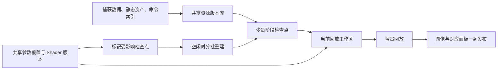

# 交互回放：全平台检查点与共享参数编辑

更新：2026-09-06，当前证据快照为 v15。本文整理已完成工作与后续实现方案；“目标”“拟定接口”和执行步骤不代表功能已经落地。历史实测保留在 [当前修复与主路线](../../output/eid-dual-state-20260905/当前修复与主路线.md)。本文更新后续路线，不改写历史测量结果；后续 v16 源码实验不计入 v15 验收。

## 1. 目标和平台范围

目标是拖动 EID 时持续显示真实回放结果与对应面板；固定 EID 调整共享参数时，优先刷新当前画面，空闲时补建受影响的检查点。普通交互不以旧截图替代回放。历史缩略图属于独立的、有界的预览功能。

公共回放层统一负责检查点选择、资源版本、参数编辑语义、失效传播、任务优先级和结果发布。驱动只实现本 API 的资源复制、绑定、同步与命令续放。不能在公共层写入“只支持 D3D”的功能判断，或把其他后端永远走完整回放视为全平台加速完成。

依据本仓库 [README 支持矩阵](../../README.md)，验收覆盖：

| API | 目标运行环境 | 参数映射与后端适配 |
|---|---|---|
| D3D11 | Windows | Constant buffer 范围、上下文绑定、资源内容、隐藏计数器等 |
| D3D12 | Windows | Buffer/CBV 范围、描述符、资源状态、alias、query、队列和续录位置 |
| Vulkan | Windows / Linux / Android | Uniform buffer 与动态偏移、descriptor、layout、队列所有权、命令缓冲区 |
| OpenGL | Windows / Linux | UBO 范围、上下文绑定、program、FBO、资源及隐藏状态 |
| OpenGL ES | Windows / Linux / Android | 按实际版本与扩展适配；不能默认具备桌面 GL 的复制、同步或 UBO 能力 |

Android 等远程回放必须包含 proxy 协议、设备端状态保存和参数更新，不能仅修改桌面 controller。主机只发送小型控制请求，检查点驻留在实际回放设备；显示数据传输另行计时。远程显示不能承诺完全没有读回或传输。

proxy 已增加检查点配置/状态/失效、共享 buffer 补丁和 force/bypass 转发；控制契约已放入 IRemoteDriver。协议修订参与连接协商，旧版本不会静默接收新格式。v15 的协议修订为 5，localhost 原生 D3D11 远程共享编辑/检查点测试确认客户端与服务端 DLL 哈希相同，原生字节与绑定输出对照通过；设备端与其他 OS 仍需独立 GPU/协议验证。客户端编辑后失效资源可用性标记，同时保留双方一致的差分传输基线。

GL 的独立 uniform、Vulkan push constants、D3D12 root constants 不是真实共享 buffer，需独立参数身份与作用域，不能伪造 ResourceId 混入共享字节范围。尤其 GLES 2 没有 UBO，完成 GLES 调参不能只实现 UBO。

Metal 在当前仓库的回放实现尚不完整，不是已有成熟后端；公共设计应可扩展，但本项不能顺带宣称补齐 Metal/macOS 或仓库之外的专有平台支持。

## 2. 目前实际完成了什么

| 工作 | 状态与证据边界 |
|---|---|
| Current/History 串图及旧异步回调抢回画面 | 已修改公共 TextureViewer 显示事务并编译；1.rdc、6.rdc 的 Qt 鼠标事件与实际输出窗口像素对照通过。锁屏环境未验证 OS 最终合成画面 |
| 历史单击预览、双击跳 EID、邻近缩略图 | 两抓帧的 v11 验收通过；缩略图有 24 张上限，大列表按附近窗口加载 |
| 四类 API 检查点基础 | 已有共享候选/预算接口及 D3D11、D3D12、GL、Vulkan 保存恢复实现；早期小型原生样例有真实命中与参考对照，不等于各平台大型抓帧或当前构建全部验收完成 |
| GLES 与远程检查点 | 已有实际 OpenGLES 3.2 抓帧及 localhost D3D11 原生共享编辑/检查点对照；Android/Linux GPU 未验证。GL 检查点仍有 copy-image 及 GLES 压缩格式限制 |
| D3D12 描述符恢复/复制减量 | 已实现并验证；属于一个后端的优化，不能概括成所有 API 的收益 |
| 1.rdc 检查点加速 | 尚未达到实时目标。v15 同 DLL、仅稀疏闭包开关对照：返回 24917 时，CP-on p50 324.349→202.320 ms，实际初值复制 7,194,475,576→3,467,411,402 B；29385 两组约 194 ms，原有 dirty 恢复已生效。两组各 44 次访问、全部绑定颜色/深度与强制参考及跨模式 witness 一致。每 EID/模式仅 8 个样本，首次关闭 CP 后的完整恢复单列；不等同于 GUI 输入延迟 |
| 6.rdc 检查点加速 | v5 异步恢复与目标命令裁剪后，早段约 43 ms 对完整回放约 50 ms；晚段约 83 ms 对 86–91 ms。这些是旧版本样本，最新优化仍须复测 |
| 共享 CBuffer 字节范围编辑 | 公共 SetSharedBufferPatch / ClearSharedBufferPatch(s) 已实现，D3D11/D3D12/GL/GLES/Vulkan 都有原生字节与画面对照；现有 SetEventCBufferOverride 保留独立临时语义。v18 原生 Material 菜单、连续输入期间发布、两个共享 EID 生效、清除恢复在 D3D11/D3D12/GL/Vulkan 全部通过 |
| 当前调参起点与按最早消费者失效 | 四类后端已有同范围连续改值与完整参考对照。D3D12 late-consumer 样例 v8 从 CP 38 开始续放，稳态更新约 2.9–3.6 ms；Vulkan 已验证跨提交/帧初始起点。v15 实际 idle API 与原生 Qt 空闲调度均已通过下述小型样例验收，前台 PrefixOnly 保留起点，空闲补建后缀；未据此宣称大型抓帧后台维护达标 |
| Linux / Android 可移植构建 | v15 最终公共源码顺序完成 Linux x64、Android ARM64、ARM32 原生构建和 ELF/符号/哈希核验。Linux GL/GLES/Vulkan、Android GLES/Vulkan 编译通过；无对应 OS/设备 GPU 回放验收，不能记为全平台运行通过 |
| 双套独立回放工作资源 | 未实现；不是实现基础交互功能的前提 |

证据：[v15 验收快照](../../output/interactive-replay-20260906/acceptance-v15.json)、[v15 稀疏闭包归因](../../output/interactive-replay-20260906/1-sparse-v15-attribution.md)、[v11 汇总](../../output/eid-dual-state-20260905/acceptance-final.json)、[共享编辑与当前构建测试目录](../../output/interactive-replay-20260906/)、[1.rdc v3 耗时归因](../../output/interactive-replay-20260906/1-checkpoint-query-v3-attribution.md)。未宣称整项性能交付完成。

### v15 实际验收与保留的失败

Windows coherent 构建包含 core、system_load、Python bindings、命令行及 qrenderdoc；原生测试 1,550 个断言/70 个 case，qrenderdoc 测试 84 个断言/3 个 case，bindings 一致性通过。翻译目录 4,884 条有效记录全部完成，新增未翻译源码文字为 0。版本身份见 [构建记录](../../output/interactive-replay-20260906/build-v15-receipt.json)；这些构建和 CPU 测试不能替代 GPU 正确性/性能验收。

| v15 验收项 | 已观察结果与边界 |
|---|---|
| 直接调用空闲维护 API | [idle-shared-late-v15](../../output/interactive-replay-20260906/idle-shared-late-v15.json) 通过。有效请求只执行 1 个工作单元，从 CP 38 新增 CP 56；过期 EID/Shader generation/buffer generation 均无工作，同 generation 重复调用无工作；当前 buffer、邻接字节、全部绑定输出与双强制参考一致，清除恢复通过 |
| 原生 Qt 空闲调度 | [material-ui-idle-late-v15](../../output/interactive-replay-20260906/material-ui-idle-late-v15.json) 通过。750 ms 定时调度实际补建：累计 builds 4→5、点数 1→2、events [38]→[38,56]；EID 73、generation 40、编辑字节与像素不变。实际探针等待 1.516 s，不把 750 ms 定时配置当成精确完成延迟；此样例使用显式开启模式，不证明默认 auto 在任意抓帧均会建点 |
| Windows GL / Vulkan 原生 Material UI | [GL](../../output/interactive-replay-20260906/material-ui-gl-v15.json) 与 [Vulkan](../../output/interactive-replay-20260906/material-ui-vk-v15.json) 均通过，真实菜单/选中字段、持续输入期间分别发布 17/26 个不同 generation，清除与 cleanup 完成。完成信号为 setter 完成、GUI 管线发布和 viewer 队列排空，非屏幕 scanout |
| localhost D3D11 远程 | [remote-d3d11-v15](../../output/interactive-replay-20260906/remote-d3d11-v15.json) 为实际远程回放，同原生 DLL 构建身份、原生 buffer 与输出像素对照通过，实际可见输出变化；不推导其他远程 OS/API 已通过 |
| 默认自动检查点 | [auto-1-v15](../../output/interactive-replay-20260906/auto-1-v15.json) 有 10 次真实 normal hit 且强制参考一致，但不能记为稳定选点成功。候选 28535 映射到原生 7690，曾在两次收益命中后 retained；新增候选配置成本计入旧点命中成本，随后旧点被拒绝，多个新候选继续映射同一原生点但没有归属。最终 automatic 为 rejected/noIndependentNativeHit、points=[]、configurationPending=true。已定位成本归属错误；保住原有 owner 后，无独立收益的新候选可正常拒绝，尚未证明必须另做原生边界合并。后续源码修正不倒写 v15 结果；混合 observing/trial/hit 的总体 p50 不是稳态 |
| 重复 query 命令列表 | [query-repeat-v15](../../output/interactive-replay-20260906/query-repeat-v15.json) 原生 query 结果独立预期、query slot 恢复及绑定输出强制参考对照通过；不扩展为任意 query/alias 检查点都支持 |
| Linux / Android | [平台记录](../../output/interactive-replay-20260906/platform-native-v15.json) status=complete，仅表示顺序构建、ELF machine/位数、idle 原生符号及冻结源码哈希通过。RelWithDebInfo 编译掉开发单测，未运行空单测入口充当通过；没有 GPU、Android 设备部署或远程握手 |
| 大型抓帧 History | v15 isolated 的 [1.rdc](../../output/eid-dual-state-20260905/ui-history-tabs-v15-isolated-1.json) 与 [6.rdc](../../output/eid-dual-state-20260905/ui-history-tabs-v15-isolated-6.json) 均为 10/10 功能 case 通过，但 loading heartbeat 超过 350 ms，整体失败。Python/native 最大间隔分别约 737/789 ms、10,734/10,724 ms；保留原始证据，未仅凭间隔认定原因或长期回归，也不用原生 replay 结果替代 History 端到端验收 |

历史对照不改写：v13 的 24917→29385 方向已有约 4.09 GB 恢复减量，CP-on 约 195 ms，反向仍约 327 ms；v15 解决的是反向被 sparse 写全量失效的问题。v14 的 [1.rdc History](../../output/eid-dual-state-20260905/ui-history-tabs-v14-output-1.json) 功能 case 通过但 loading heartbeat 最大 391 ms，超过 350 ms 阈值，整体仍为失败；[6.rdc History](../../output/eid-dual-state-20260905/ui-history-tabs-v14-output-6.json) 在 warm 阶段超时。前者的 Python/原生 GUI 调度归因尚不能仅凭一次 heartbeat 下结论；后者存在 inactive 窗口鼠标 receiver 路径问题，修正 fixture 后也仍需新版本实际结果。v11 的历史通过记录仍保留。

## 3. 内存中的组织方式

采用“一个已加载捕获 + 共享资产 + 少量阶段检查点 + 一个当前回放工作区”。使用体验接近多个小 RDC，但不复制整个捕获和设备。

| 数据 | 保留方式 |
|---|---|
| 捕获字节、创建描述、反射、未修改 Shader/PSO、已证明只读的网格与纹理 | 捕获内共享；数值编辑不重建这些对象 |
| 原始初值 | 保持不可变，供初次回放及撤销编辑使用；不是每个检查点复制一份 |
| 某阶段的颜色、深度、可写 buffer 等内容 | 引用资源内容版本；相同版本共享，确实变化的版本才另存 |
| 绑定、descriptor、layout、alias owner、query/counter、命令位置等 | 保存可恢复的 API 状态；不可用面板 PipeState 的展示副本替代 |
| 当前工作资源 | 执行命令、接收恢复及编辑；跟踪实际写过的范围或保守整资源 |
| 当前调参起点 | 保存受影响渲染开始前的必要状态；复用同一套检查点机制，随当前编辑会话维护 |

第一版按整资源或已经验证的子资源版本共享，不承诺对所有原生纹理进行任意字节/显存页的写时复制。内容相同可以通过“没有发生写入”直接复用版本，不要求每帧读回 GPU 计算内容哈希。

可选第二工作区只用于隔离后台构建，待单工作区方案的恢复成本与显存量实测后决定。两套工作区可以共享不可变资产，但可写资源、可变描述符和同步对象必须隔离。多建一个 context/controller 不会自动解决这些状态问题。

## 4. 两条交互路径

### EID 导航

1. 找到不晚于目标 EID、依赖版本有效且预计总成本最低的检查点。检查点表示边界 EID **执行完成后**的状态，从它的合法后续位置继续。
2. 在进行任何恢复写入前，验证资源身份、版本、预算、命令/队列续放以及隐藏状态。
3. 为每个需要恢复的资源选一个最终来源：检查点版本、原始初值，或已证明相同而保留当前内容。避免先恢复初值又覆盖成检查点内容。
4. 恢复必要的内容与环境，再执行到目标 EID；非必要的面板统计和历史工作延后。
5. 图像、实际 EID、输出资源及轻量管线快照按同一个完成请求发布。RT0 默认选择与用户的输出偏好在公共 UI 层处理。

依赖不完整或发生恢复失败时，重新建立完整初始状态再回放，不能从半恢复状态继续。对单个不支持的捕获片段允许正确回退，但对应后端的加速验收仍记为未完成。

### 固定 EID 调整参数

1. 解析共享参数身份及影响范围，为当前画面确定最早需要重新执行的位置。
2. 保存该位置之前的有效调参起点。若只影响当前 draw，可以是 draw 前；若很多早期事件共享该参数，则必须早于这些相关消费者。
3. 每次输入只保留最新待处理数值，复用资源创建、反射、绑定布局及仍有效的命令模板。
4. 恢复本轮要重复执行的操作可能改变、读取的必要状态，应用最新数值，重跑影响当前结果的区间，立即显示。
5. 输入停止后，低优先级补建其他受影响且值得保留的检查点；未受影响的检查点继续共享原版本。

只更新当前输出依赖的前台路径，要记录它覆盖的资源和状态范围；这种局部有效结果不能冒充可供任意后续 EID 使用的完整检查点。Mesh/Buffer Viewer、像素分析或切换 EID 要读取范围之外的数据时，先补齐对应状态。后台只有保存到所声明的完整恢复范围后，才可发布通用阶段检查点。

固定 EID 可以省掉导航和反复提取完整面板，但不能在上一次最终输出上直接反复画：混合、深度、Stencil、UAV 累加、覆盖范围变化及 discard 都可能留下前一次结果。恢复的是渲染所需状态，不是用于显示的截图。

例如：只影响最后曝光的参数可保留深度、GBuffer、光照，仅重跑后处理。若参数影响当前结果依赖的阴影或 GBuffer，则这些上游结果必须参与本次更新。不能先显示使用旧上游的新参数结果，再把必要的正确性工作全部推给后台。

## 5. 共享参数与精确失效

共享 buffer 编辑键为：

`capture/session + canonical ResourceId + (bindingBaseOffset + member/arrayOffset) + byteLength`

由实际反射和绑定确定范围。参数类型用于把数值编码为字节；变量名、选中 EID、shader slot 不替代物理范围。同一资源的同一范围共享修改，不同偏移独立。相同 GPU 地址的不同生命周期资源不能直接合并。

用户设置保存在独立编辑层，原始资源初值保留。后续捕获上传、Map、Copy 或 GPU 写入覆盖该范围时，在相关消费者执行前按定义重新应用编辑，避免捕获命令静默撤销用户参数。多个覆盖范围相交时要合并成确定的最终字节版本，不能依赖容器遍历顺序。

现有单 EID 临时覆盖继续保持原有语义；共享持久编辑另设公共接口，避免把临时实验结果写入正常前缀。新接口不继承当前公共 setter 中 D3D 的 64 KiB、16/256 字节和寄存器空间假设；这些由后端验证绑定窗口，用户修改的叶子范围不要求等于完整绑定窗口。

版本分开管理：

| 版本/信息 | 用途 |
|---|---|
| Capture/session epoch | 丢弃旧捕获的任务、资源及回调 |
| 资源内容/范围版本 | 判断哪些输入输出与检查点仍然一致 |
| 参数版本 | 标识实际应用与显示的数值；不直接销毁未变的上游起点 |
| Shader/管线布局版本 | 更新代码、派生管线、可能访问范围；值变更不升级布局版本 |
| 视图请求及完成序号 | 防止 History、旧 EID、旧任务发布到错误的面板 |

编辑后立即更新有效性，后台只延后重建。最初可从最早可能消费处保守失效后缀；补齐依赖覆盖后，只重建输入版本或执行代码改变的检查点。后缀中完全无关的资源版本继续共享。全局 generation 可以取消任务，但不应作为所有检查点一律失效的唯一依据。

依赖索引必须包含绑定窗口、CPU 写入、GPU 写入、copy、动态 descriptor、间接命令和物理 alias；不能把 GetUsage 没报告写入当作未写证明。数值即使不改格式，也可能改变分支、descriptor 索引、间接参数或写入区域，因此不能只沿上一次观察到的访问路径推导影响。

Shader 保存允许同步编译和较慢更新：保留最后有效版本，验证新 Shader 后重建受影响的派生对象和结果。恢复原始 Shader/参数也使用相同的依赖与版本机制，不要求重新加载整个 RDC。

## 6. 检查点放在哪里，后台如何维护

候选来自实际动作类别、输出绑定和模块边界；Depth、GBuffer、Lighting 等标签是提示，实际 API 的合法提交/render-pass/query 边界决定能否恢复。文件压缩体积、固定 EID 间隔或语义标签都不足以决定位置。

结合以下量选择少量候选：

- 从前一有效起点到候选的实际回放成本，以及用户经常访问的区间。
- 保存和恢复必要资源版本的耗时、新增物理占用、跨点可共享的数据量。
- 后缀长度、合法边界、设备可用预算与前台工作的显存余量。
- 编辑时最早受影响的消费者，以及哪些检查点可在多次调整中保持有效。

共享 planner 提供 2–3 个候选与大小预算。默认自动模式从普通回放开始，实际重复访问建立基线后才试建；保存、恢复、后缀与完成的净收益必须能偿还构建成本，才保留并尝试第二个点。自动预算最多 512 MiB，首次共享调参试建最多 64 MiB；显式开启模式仍使用 64 MiB–2 GiB 的估算范围。强制参考与自然基线分开：自然基线禁用检查点，保留普通脏资源恢复优化。长阶段只在后端合法且能完整恢复的位置细分。

调度保持最多一个执行中的交互请求，待处理输入合并为最新值。后台在同一 replay 调度体系内分批工作，每批检查是否有新输入；已经提交的 GPU 命令不能瞬间取消，不能提前排入长队列。后台改变工作区后，任何前台读取前必须恢复其对应的真实状态。

固定 EID 持续输入时，允许显示同一会话内单调前进的已完成参数版本，再追上最新值；不能因为输入一直更新而把每个完成结果都丢弃，导致只有停手才刷新。显示应记录实际完成版本，不能把旧数值的图像标成最新值。切标签、关闭捕获或切换展示身份则必须拒绝旧视图任务。

新检查点只有在 GPU 复制完成、依赖版本仍匹配后才能原子发布；旧版本待引用与 GPU 工作结束后释放。小块参数上传应使用有完成同步保护的槽，减少全设备等待；复用对象不意味着可以覆盖 GPU 正在读取的数据。

## 7. CPU 工作与 GPU 工作分开减少

| 工作 | 处理方式 |
|---|---|
| 捕获解析、资源创建、反射、动作及绑定索引 | 加载时/首次使用构建，按相关修改版本复用 |
| 命令解码与状态指令 | 公共区间索引加后端可复用命令模板；仍有数据依赖和资源地址嵌入约束 |
| 原生命令录制 | 能复用就复用；只有参数补丁、绑定地址或实际执行区间变化时重新准备必要部分 |
| 内容恢复 | 跟踪实际执行后的脏集合，选择最终版本一次恢复；状态转换、同步仍必须正确 |
| 当前图像及对应输出标签 | 交互期间持续发布，不能全部拖到鼠标停止 |
| 大量统计、历史缩略图、完整文本与非当前面板 | 空闲队列、按需加载、可取消或合并 |

不能把绘图前必需的命令遍历/绑定恢复全部推迟。D3D11/GL 不应被迫模拟 D3D12 command list；Vulkan 的 primary/secondary、render pass 等边界也由后端实现。公共层统一“准备一个区间、恢复状态、执行区间”的语义。

## 8. 实施顺序与公共接口边界

以下为职责边界；共享字节编辑、检查点控制及远端转发已添加，完整依赖调度仍在实现：

| 公共职责 | 后端能力 |
|---|---|
| 参数身份、覆盖合并、原值与撤销 | 验证原生绑定；在 CPU/GPU 写入及消费边界应用 buffer 范围补丁 |
| 依赖、版本、候选、预算和收益选择 | 报告合法边界及完整性；保存原生内容、环境和续放位置 |
| 制定恢复计划并验证版本 | 执行一个最终恢复来源；失败后可靠完整复位 |
| EID 导航/固定 EID 编辑会话 | 执行相关区间，提供实际写入及同步完成信息 |
| 任务优先级、发布与统计 | 有界执行单元及完成句柄；API 专有错误转换为稳定能力/拒绝原因 |
| 本地/远程统一请求 | proxy 版本协商；设备端持有检查点、编辑状态和调度 |

执行分四个闭环，每个闭环都列入 D3D11、D3D12、Vulkan、GL/GLES 和远程链路，不按“一个后端功能全做完，其他永远回退”交付：

1. **统一编辑语义与状态版本。** 新增共享范围编辑、原始恢复及保守完整回放作为正确性参考；补齐 proxy，明确无 buffer 的常量类型。建立可说明完整性的写入/消费索引，未知范围保守扩大。
2. **统一恢复计划与阶段续放。** 先验证后写入；每资源一个来源；四类后端接入。D3D12 当前“初值再检查点”重复恢复、alias/query 是必须解决的后端问题，其他后端单独验证各自隐藏状态。
3. **当前调参快路径与成本选点。** 固定 EID 保留有效起点，复用环境，只重放受影响区间；把大型 RDC 的实际复制量、恢复成本纳入检查点位置和数量选择。
4. **后台局部补建与远程体验。** 交互优先、参数合并、单调发布、空闲分批重建、共享版本回收；依据测量再决定第二工作区。补齐各 OS/设备的原生和端到端验收。

源代码入口：[公共回放控制](../../renderdoc/replay/replay_controller.cpp)、[驱动契约](../../renderdoc/replay/replay_driver.h)、[远程 proxy](../../renderdoc/core/replay_proxy.h)、[公共交互调度](../../qrenderdoc/Code/CaptureContext.cpp)、[纹理展示](../../qrenderdoc/Windows/TextureViewer.cpp)。

## 9. 时间日志与验收

每次请求携带 capture、API、设备、EID、视图、参数版本、选中检查点和路径类型，区分首次构建、命中、重建、完整回退。分别测量排队、恢复计划、内容恢复、CPU 解码/录制、提交/等待、必要面板获取、显示提交、远程传输和后台构建。

记录恢复字节、实际写入资源数、共享/新增/暂存内存、最早重放 EID、重新执行的动作数、过期任务数、输入至画面延迟和呈现间隔。CPU wall time、GPU 时间戳、UI 呈现不是同一指标；嵌套 timing scope 不能相加。

1.rdc 已记录稳态恢复约 7.68 GB 内容，已有 2,212 个只读资源被跳过。这个数据指出应重点减少内容恢复，但不是 GPU 总线流量，也不能把 fence 等待全部归为上传。新的优化必须以同 DLL、同设置的开启/关闭对照确认。

统一验收包含：

- 前后往返、随机 EID、跨模块、RT0 默认及手动输出记忆；每次发布图像与面板身份一致。
- 共享同一 buffer 范围的多个 EID 都变化，不同偏移不串改；捕获上传覆盖后仍符合编辑语义；清除编辑恢复原始结果。
- 非零 binding offset、数组/矩阵布局、动态 offset、多阶段绑定、跨 64 KiB 范围和相邻未编辑字节独立验证；用户 patch 范围与原生上传/绑定对齐分开处理。
- 固定 EID 连续 A→B→A，在混合、深度、discard、UAV/counter 等案例中与应用相同编辑的完整回放一致；持续输入期间持续出图。
- 上游参数修改只保留真实有效的检查点；后台旧版本无法发布；Shader 保存、失败、恢复均正确。
- alias、query、间接、动态访问、预算不足、部分恢复失败、分析工具插入、设备/捕获切换都有正确结果或明确的回退原因。
- 全部 bound color/depth 与必要 buffer 输出对照；性能测量与诊断读回分离。非确定性 GPU 结果使用明确的比较方法，不把差异静默算作通过。
- D3D11/D3D12、Vulkan、GL、GLES 各有实际命中和编辑验证；Windows、Linux、Android/远程分别记录 build、GPU、驱动和协议版本。Windows 上跑过四个 API 不能等同于各 OS 都已验证。
- 远程旧服务端、断线重连、强制参考回放、客户端缓存失效及低预算回收单独验证；对每个组合标明“实现且通过 / 仅回退 / 未测 / 不适用”。
- 单列检查点建立成本、稳态 p50/p95、切点延迟、固定 EID 调参延迟、后台抢占和峰值显存；达到正确性但没有提速的案例记为性能未完成。

流畅度以实际交互端到端结果验收。16.7/33.3 ms 可作为 60/30 Hz 的设计预算参考，不能在尚未测到时写成承诺；若必要的 GPU 工作本身超预算，应明确剩余瓶颈，而不是使用旧图伪装实时回放。
