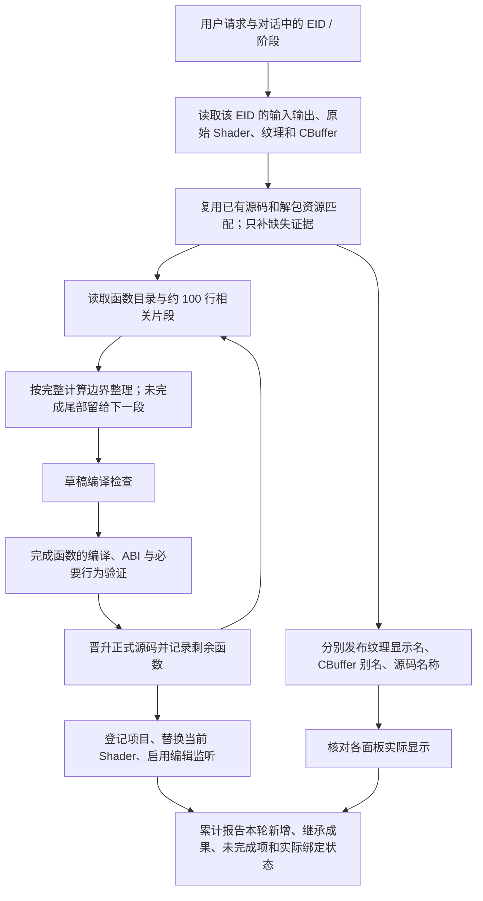

# 2026-09-22 Shader 整理对话审计

对象：白银项目的 `6.rdc`，EID 11384，PS / MainPS。所有下列时间均为北京时间（原始日志为 UTC）。这是对两轮实际执行日志、持久回执和源码的交叉核对，不是仅根据最后一条 AI 回答判断。

## 结论

问题没有全部解决。本次使用的是 16:17 已部署的修复版 Host，不是再次漏部署。打开捕获时恢复 3/3 Shader，只证明恢复路径成功，不能证明“继续整理、反复审核、实时编辑、面板别名、最后总结”整条链路正确。

这次有有效成果，但大部分时间没有用于有意义的函数整理：第一轮主要将旧草稿审核、晋升并应用；第二轮写入 CBuffer 别名、改名并发布了一个新辅助函数，随后遭遇验证与实时编辑的内部状态冲突。最后的“没有进行 CBuffer 重写”和“被 Bread 之外更改”不能当作完整事实。

## 谁控制什么

| 层 | 实际职责 | 本次观察 |
|---|---|---|
| 模型 / 原生 Agent | 理解用户目标、选 EID、查证据、决定名字和函数边界、决定下一次调用 | `codex-app-server` / `gpt-5.6-sol`，并非 API 主 Agent；采用供应商原生循环 |
| Bread Agent 适配层 | 提供上下文和技能、暴露工具、保留任务事实、触发续跑与处理报告 | 两轮的任务完成状态不一致；第二轮多次续跑后仍遗漏早先成功的命名结果 |
| Python Host | 管理工作区、源版本、工具事务、编译/审核、命名回执和项目登记 | 只读列举结构也重复重建旧草稿；临时审核与监听没有隔离 |
| qrenderdoc Bridge / UI | 调用重放 API，管理替换记录、编辑窗口、CBuffer 面板 | 名称字典写入和当前反射布局显示没有贯通 |
| RenderDoc C++ 重放核心 | 真正建立、使用、释放 GPU Shader 资源及替换关系 | 用集合记录可重复取得的 D3D12 Shader ID，临时释放可能注销仍在用的对象 |

Host 应验证一次操作是否能正确执行，不应替 AI 决定要分析什么。编译、当前目标和物理布局检查仍有必要；旧聊天、旧草稿和旧别名的管理信息不应成为独立分析工作的门槛。当前实现仍有报告门禁、续跑计数和工具前置条件参与控制，不能概括为“Host 已经完全只提供工具”。

## 应有的完整流程

至少要区分四个状态：磁盘正式源码、组织草稿、已编译候选、GPU 当前替换。草稿能编译不等于已晋升，正式源码已晋升不等于 GPU 已替换，别名字典落盘不等于当前面板已经显示。

## 这次实际做了什么

第一轮是 16:44:05–16:58:59，共 14 分 54 秒。48 次顶层 MCP 调用中，有 26 次实际工具、20 次能力/schema 查询、1 次技能读取和 1 次报告。

展示的 23 项结构操作和 16 个注释来自 9 月 21 日。这轮没有新增结构抽取，而是重新审核旧草稿，发布 revision 81，再应用、注册并打开编辑。两次仅列举结构的调用各耗约 160 秒，合计 5 分 19 秒：只读 `operation=list` 也多次重演了旧结构操作。

第一轮并非应用失败。16:57:28 的旧工作区占用错误之后，Host 自动回滚闲置旧占用，16:57:37 重试成功。但其 `completionContract` 为空，最终允许以 partial 结束，未完成这次“重新整理”的目标。

第二轮是 17:02:05–17:59:08，共 57 分 03 秒。331 次顶层 MCP 调用中，实际工具 271 次、能力/schema 查询 44 次、技能读取 10 次、报告 6 次。其中有 102 次证据文件读取、48 次大纲/局部查看、27 次源码读取；这不是 331 次有效改动，也不能把 Host 的内层追踪重复统计成 AI 调用。

| 时间 | 实际动作 | 结果与局限 |
|---|---|---|
| 17:02–17:06 | 读取状态、恢复组织会话和基线 | 重新准备已有工作 |
| 17:06–17:16 | 查解包材质及同平台 ShaderMap，4 次尝试发布 CBuffer 别名 | 最后写入 41 行、1 个块别名，0 跳过、0 拒绝 |
| 17:16–17:19 | 改声明并审核 revision 82 | 378 个标识符改名；包括 `normalIntensity`、`trailSpeed` 等，但也有大量偏移名称 |
| 17:19–17:27 | 大批量改局部量并发布 revision 83 | 2,895 个名称几乎全仍是通用编号，结构未因此变得清楚 |
| 17:27–17:30 | 应用 revision 83、登记、开监听并报告 | 应用成功；整份整理仍未完成 |
| 17:30–17:41 | 续跑，提取 `ResolveMaterialIndirectionFrame` | 一个新辅助函数正式发布到 revision 85 |
| 17:41–17:46 | 提取 `LoadPrimitiveLightingBasis` 并审核 | 草稿存在，重放比较失败，未成为通过审核的后续成果 |
| 17:46–17:59 | 状态查询、恢复尝试、重复应用与多次报告 | 内部替换状态未恢复，最后让用户处理 |

证据限制：前 3 次 CBuffer 发布的完整工具错误没有留存在现有日志中，不能给它们编造精确错误码。保留的推理摘要显示它在反复修正反射成员起始偏移；能确定的是 4 次独立调用和最后一次 41 行的提交结果。

批量编号改名后，源码从 359,083 字节增至 543,822 字节，行数仍是 5,138。比如把短编号换成 `mainPSinnerValue123`，只是把编号写长了。改动卡片还以旧反编译原文作累计比较，因此巨大增删数字不代表本轮新增了同等规模的有效整理。

还有一个版本衔接问题：工作区的 `source/shader.hlsl` 已保留 revision 85 发布后的内容（544,386 字节，后来失败的审核把 manifest 编译修订推进到了 89），但项目当前登记的正式版本仍是 revision 83（543,822 字节）。因此“工作区源码已晋升”和“项目恢复版本已更新”也必须区分。重新打开 RDC 会恢复已登记的 83，不会擅自把尚未登记的本地 85 当成项目正式版本。两个版本都保留着；本次修复没有替 AI 静默晋升项目版本。

## 错误如何串起来

截图中的 8 行红色日志对应 6 个失败事件，后两次目标错误分别有两层日志。前 3 个已在当时恢复：

| 错误 | 实际含义 | 本次结果 |
|---|---|---|
| 两次 `operation_id` 格式错误 | AI 给了不符合该工具要求的操作编号；这是幂等编号，不是资源匹配失败 | 随后均重试成功 |
| 工作区占用 | 自动恢复的旧工作区仍持有同一 Shader | Host 已自动停止旧监听、回滚并接管成功 |
| `not created by BuildTargetShader` | C++ 控制器不再把该资源登记为有效目标 | 持续故障从 17:46:13 开始 |
| 两次 `changed outside Bread` | 活动对象与 Bridge 记住的替换对象不一致 | 未恢复；该文案不能证明用户或外部程序修改过 Shader |

操作编号还有接口一致性问题：结构编辑工具接受 8–128 个 ASCII 字符，而共享 Shader 应用要求 32 位小写十六进制，同名参数不能套用同一格式。应用工具本来允许省略后由 Host 生成。应把格式约束清楚地放进工具 schema，或统一外部操作编号约定；不需要用户提供这种内部编号。

核心生命周期缺陷是：D3D12 会复用相同字节码的 Shader ID，每次构建又增加一次引用；控制器却只记录“这个 ID 在不在集合里”。审核或反射临时取得同一个 ID，结束时释放一次，控制器就把仍被正式替换使用的 ID 从集合和替换记录里删掉。后续恢复检查因此失败。这个路径能由 Bread 自己触发，不需要外部操作。

独立的并发缺陷是：审核把草稿临时写到正式源码位置并编译，监听把临时候选当成保存结果。日志中 revision 84、86、88 三次排队，最后都报“预期保存候选已不存在”。验证事务必须隔离这些临时版本；真正晋升后再让监听读取正式结果。

## 为什么 CBuffer 写入成功却看不到

17:15:52 的持久回执明确记录 `applied=true`、41 行和 `CharacterMaterialParameters` 块别名。这反驳了最后报告中“本轮没有重写 CBuffer”的说法。

但面板从当前替换 Shader 的 reflection 查名称，字典 key 却包括原始块名、原始成员名和偏移。原始 `cbuffer5.unknown[N]` 被重建为 `CBufferS0B5` 和独立标量后，key 改变，旧字典找不到；当前的 ResourceId 回退也要求布局 key 相同，无法补救。这里确实是 b5/space0，不是寄存器和 space 颠倒。

不能直接忽略布局，把 41 行名字按 offset 套给当前 float：旧字典没有保存完整类型/跨度，而且不少名称代表 16 字节的一组向量参数。需要保存或取得原始反射，通过原始程序、stage/bind/space、偏移、类型和分量范围建立到当前展示布局的映射。发布结果还应分别报告“已保存”与“当前面板实际可见”。

别名发布的 Bridge 当前还先检查活动替换归属。这把原始 CBuffer 的命名写入错误地绑到 GPU 替换成功上；已有原始目标证据时，这两个过程应解耦。

本次没有新增纹理显示名称发布。`ai/aliases.json` 变小是阶段映射重置，不等于源码改名消失：旧阶段映射仍在 accepted-stages，实际源码也保留了名称。

## 旧内容怎样自主处理

旧草稿、旧别名和旧会话记录是可修复的管理数据。应保留备份和诊断，修复可证明的关联；无法复用的自动隔离并重新生成。不能把“不兼容旧文件”转成让用户手动删除文件的任务。

GPU 替换状态不同于磁盘文件。删除 JSON 不会重建已损坏的 GPU 对象。应该先停止该目标监听，用当前 capture/session、原始 Shader 和确切替换记录执行工具提供的回滚，再从保留的正式源码重新编译应用。仓库已有回滚与精确恢复工具，也在 replay 权限工具列表中；但 `task_report.py` 的 `require_shader_delivery_reversal` 还要求匹配当前聊天的 delivery 记录。这是可能阻断旧工作区恢复的遗留限制，不能仅靠要求 AI “更自主”解决。修复方向是由实际 capture/原始目标/替换对象及监听状态验证回滚，旧聊天记录只作为证据。仍需验证实际 owner 和回滚结果，不能盲目清除别的目标。

## 本次修复与验证记录

- 已修正 C++ 目标资源引用计数：临时引用释放不注销仍在使用的替换，最后一次释放才清理；退出时按取得次数释放。
- 已编译 Development `renderdoc.dll`，新增生命周期回归测试通过：3 个测试、77 条断言，覆盖重复 ID、临时释放、正式替换保留、临时取得原始捕获 ID 与退出清理。
- 已修正临时审核与监听隔离：审核持有跨进程观察事务；监听和自动应用非阻塞等待，正式源恢复或晋升后再接续。进程退出会释放操作系统锁，遗留空锁文件不会阻断后续工作。被新版本替代的排队候选按正常 superseded 处理。
- 已修正结构只读列举：直接读取当前草稿和保存的操作记录，不再重建全部历史结构，不编译也不改写源文件。
- 在实际已部署 Host 上，对这份大型工作区的当前阶段调用 `operation=list` 用时 4.421 秒，返回 `proposal-read-only`；正式源、草稿和 manifest 的调用前后哈希不变。当前阶段只有 1 个待审操作，历史已晋升，因此这不是与旧 23 操作阶段完全相同输入的性能 A/B，不能据此宣称固定加速倍数。
- Python 定向回归通过 193 个测试和 34 个子测试；补充数值比较、源事务、内部实时编辑及生命周期回归通过 123 个测试，总计 316 个测试和 34 个子测试。
- 导入凭据修复的项目、恢复、工作区路由和活动项目工具回归另有 302 个测试、175 个子测试通过，1 项跳过。源码和清单写入失败的事务回滚检查也已重跑通过，计入同一用例，不重复累计。
- 生命周期、审核隔离和列表读取修复于 19:25 首次部署；补充导入凭据修复后，最终包于 19:44:24 生成，19:45:23 部署。全部 4 个运行文件哈希核对通过，旧窗口与 Host 正常退出，19:45:36 从 `x64/Development/q_render_soco_doc.exe` 重新打开同一份 `6.rdc`。运行版本号仍为 1.13.8，辨别本次包应同时看生成时间和哈希，不能只看版本号。
- 19:27 的实际重新打开又发现导入回执更新缺陷：项目已登记的 revision 83 内容成功复制到恢复工作区，但工作区仍持有上一个项目版本的 `projectSource` 知识编号、哈希和不可变输入，导致恢复结果 2/3。它与先前的 EID 漂移不是同一个错误。两条 seed 路径原先只更新文件内容，没有同时更新旧导入回执；再次尝试时内容相同又跳过 seed，继续被旧回执阻断。现已修复：用当前项目正式版本生成新的导入凭据；即使源码字节已相同，也自动刷新过期凭据，然后重新验证。旧凭据不再要求先修好才能导入新版本。没有删除用户源码、伪造历史验证结论或跳过当前编译接口检查。
- 最终已部署程序的正常启动自动恢复于 **19:47:21** 完成：`attempted=3, applied=3, failed=0, skipped=0`；实时编辑 `enabled=3, failed=0`；`warnings=[]`、`error=null`。覆盖原始 Shader 723、755、860，捕获会话为 `0e30cd020ca4463b824da341eb530436`。当时界面当前 EID 仍为 13353，恢复通过各目标自己的代表 EID 执行。此前也用正确初始化的源码 Host 在真实捕获上验证了旧凭据自动更新和 3/3 应用。
- 这次真实验证范围是 Windows Development、D3D12 和用户这份 `6.rdc`。没有再运行一整轮 57 分钟 AI 整理对话，不能据此宣称 ACP/API 所有运行方式、所有平台和游戏引擎均已完成适配或端到端验收。
- CBuffer 当前布局显示、旧聊天 delivery 回滚限制、累计报告遗漏、编号改名质量和整个任务的完成判定仍是独立问题；不能把前面的修复称为全链路完成。

## 可复核证据

- 两轮任务：`C:/Users/YC/AppData/Local/ReplayLab/ai-tasks/3f58ae52012845fdb855b4a90cb9d3af.jsonl`、`0a797fd9ea91434782cc5a00c5051637.jsonl` 及各自 `.report.json` / `.report-state.json`。
- 原生调用：`C:/Users/YC/AppData/Local/ReplayLab/logs/agent-core.log.1`、`agent-core.log`；Host 耗时：同目录 `host-memory-trace.jsonl`。
- GUI 成功/失败序列：`C:/Users/YC/AppData/Local/ReplayLab/console-events/events.qrenderdoc.33176.8584dde481af4fe1a839609a8e72deee.0000.jsonl`。
- 最终自动恢复记录：`D:/Study/抓帧/ReplayLab Project/.replaylab/replay-project/derived/restore-results/11353dae52c609bdfe4aa35cb66e48ba74390754776206c43ac4dbe69d4566d0.json`；最终窗口日志：`C:/Users/YC/AppData/Local/ReplayLab/console-events/events.qrenderdoc.33276.9693739bcfe24277add497d36aaac51c.0000.jsonl`。
- 工作区：`D:/Study/抓帧/ReplayLab Project/workspaces/shaders/v2/79db06472d2f24578cd585410b2fc74f60b93369587df855c29a450c33978dc9`，重点是 `source/shader.hlsl`、`ai/cbuffer-name-publication.json`、accepted-stages 和 `live-edit/b83328229e904e8d87ddc8245f08a007.json`。
- 原生资源管理：`renderdoc/replay/replay_controller.cpp`、`renderdoc/driver/d3d12/d3d12_replay.cpp`。
- 面板别名：`qrenderdoc/Windows/BufferViewer.cpp`、`qrenderdoc/Code/ReplayLab/ReplayLabCBufferAliases.cpp`。
- 审核和读取：`replaylab/mcp_host/src/shader_workspace/organization.py`；A/B 临时对象：`replaylab/renderdoc_mcp_bridge/shader_validation.py`。
