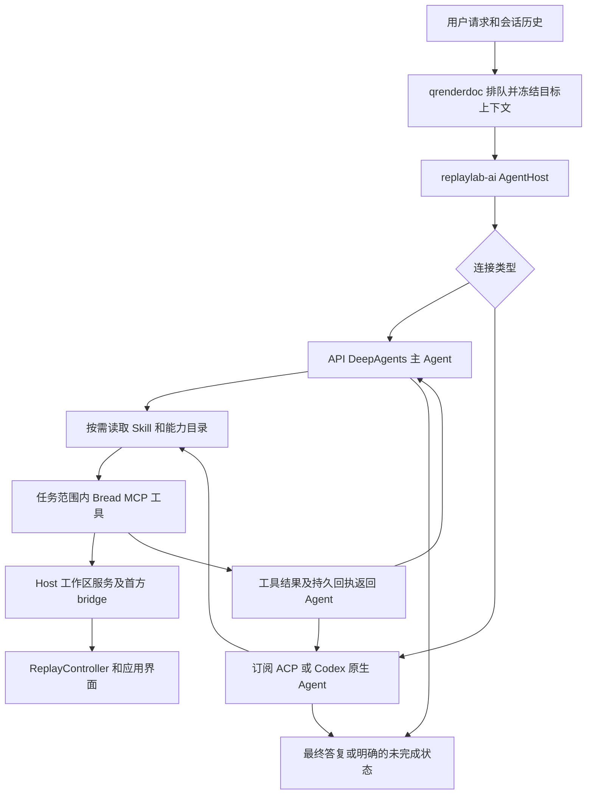
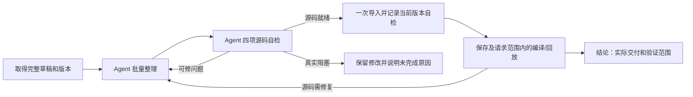

# Bread AI 执行流程与卡顿审计

本次检查覆盖 2026 年 10 月 12 日最近两轮 Shader 对话、ACP/Codex 与 API 执行器、Skill 加载、工具授权、任务终态，以及聊天和捕获上下文的性能路径。结论是：请求已经交给对应 Agent 自主处理，但“模型回合正常结束”不能证明“用户目标完成”。最近两轮没有宿主强制截断的证据；第一轮完成了少量局部改动，随后过早宣称整理完成。

## 最近两轮实际执行

证据来自本机 `%LOCALAPPDATA%/ReplayLab/ai-tasks/` 中的任务事件与同名 `report-state.json`，并与 `%APPDATA%/q_render_soco_doc/ReplayLab/conversations/` 的原始用户消息对应。事件耗时由首尾 `timestampUnixMs` 相减，不将日志显示时区混入统计。

| 用户请求 | 任务 | 耗时 | 已结束的 MCP 调用 | 主要证据 |
| --- | --- | --- | --- | --- |
| 帮我重新整理这个shader | `8e49e3aab04b4d75931e996d8b2d5130` | 603.524 秒 | 38 | Skill 加载 3 次，outline 10 次，restructure 3 次，finish 2 次。答案仅列举几处 RGB 合并，却以“已整理”收尾。 |
| 你貌似没有进行重新整理，为什么？那里卡住了么 | `87be13ea0c6d480e8d92a5201fcbfb2d` | 2674.917 秒 | 156 | outline 39 次，文件读取 73 次，finish 和 apply 各 3 次；最终回答承认上一轮过早判断完成。 |

第二轮的 Host 统计没有记录这些工具发生错误。其文件读取累计约 111.9 秒、outline 108.9 秒、begin 140.1 秒、finish 123.7 秒、apply 62.3 秒，项目登记另约 65.4 秒。调用存在并发与排队，不能将客户端每条调用耗时相加作为整轮耗时。日志也不能单独证明最终 Shader 已满足所有可读性要求；它只能证明实际调用、回执和模型说了什么。

## 请求如何执行

`AIAssistant.cpp` 管理队列、捕获上下文、进程树、事件流及显示。连接配置选择 `native_engine.py` 或 `deep_engine.py`。API 使用 DeepAgents 的模型和工具循环，可调用子 Agent；订阅模式由原生 ACP/Codex Agent 决定下一步。宿主不按 Shader 阶段替模型规划，也不在普通 `end_turn` 后添加强制验收回合。

常用工具直接提供给模型；长尾操作通过 `list_bread_capabilities` 发现，再经 `invoke_bread_tool` 执行。Skill 提供目标和证据标准，不授予权限、不强制工具顺序。完整 Skill 必须存在于当前 Agent 自己的上下文中；共享的 `loadedSkills` 标记只说明曾向某个角色发送过，不能代替正文。

## 本次修复

| 问题 | 修复后的行为 | 主要位置 |
| --- | --- | --- |
| 进度文字被当成最终答复 | ACP 只使用最后工具后的答复；API 开始下一工具时清除先前终答候选。缺最终答复按已有执行证据返回 partial 或 failed。 | `acp_session.py`、`native_engine.py`、`deep_engine.py` |
| 截断或中断没有清楚解释 | ACP 明确返回 max_tokens 时在原会话最多续接两次；API 识别供应商截断元数据并报告 partial；连接重试耗尽时保留已有结果并说明中断。 | 两个 engine |
| 工作区写能力降级对模型不可见 | 将实际只读限制、原因和 Bread 工具替代路径传入原生 Agent。 | `connectors/codex_app_server.py` |
| 阶段保存被当作全任务完成 | 主 Agent、原生 Agent、子 Agent 共用完成标准与恢复规则。可完成的剩余工作继续做，最终答复说明实际完成范围和阻塞原因。 | `agent_prompts.py`、core v26、Shader Skill v79 |
| 不必要的重复读取和最终化 | 复用当前有效 Skill、源码范围和回执；修改后只查受影响部分；批量相关改动后再做必要的昂贵验证。已有完整登记回执时不再为证明进度额外登记。 | Skill 及其 references |
| 一次只读请求重复 status | outline 默认路径从三次完整 status 降到一次；显式路径及解释文档读取从两次降到一次。下一请求仍重新验证，不缓存跨请求权限或源版本。 | `mcp_host/src/server.py` |
| 流式界面每 4ms 全文分段并插入一个字形 | 每 33ms 批量显示已收到的文本；取消人工逐字追赶。 | `AIConversationView.cpp` |
| 进程退出后一次性消费大量事件 | 最后排空也使用每轮 128 条和约 4ms 的消费预算；慢磁盘仍保证取得进展。 | `AIAssistant.cpp` |
| 逐字重复写累计进度全文 | 不再把每个 Codex progressNote 累计快照重复写入 agent-core.log，保留独立消息增量与工具生命周期。 | `native_engine.py` |
| 只读上下文强制重放同一事件 | 这两处读取不再传 force=True；EID 改变或事件状态失效时底层仍重放，Shader 替换自身的强制刷新保持原行为。 | `renderdoc_mcp_bridge/__init__.py` |
| 必要重放持有 Python GIL | 仅在 SWIG 的 SetFrameEvent 原生调用期间释放 GIL，并用 RAII 恢复；参数转换和其他 API 仍持锁，不改变回放线程归属。 | `qrenderdoc/Code/pyrenderdoc/renderdoc.i` |

这些修复保留 Agent 对语义完成的判断权。10 月 13 日的追加实现将 Shader 整理自检接入执行生命周期，见下文；不按答案关键词判断完成，不对源码做 Host 语义评分，也不设固定自检轮数。

## 权限和自助恢复边界

`allowed_effects` 定义任务可用的 workspace、project、ui、replay 等效果范围。任务代理绑定捕获身份与实际参数，已授权 Bread 操作自动批准。新增 Skill 不会扩大这个范围。

Codex 的原生命令和文件工具限制在当轮工作目录；原生网络关闭，机器级审批策略为 never。工作目录写范围无法验证时降为只读，项目与 Shader 仍可使用已授权 Bread MCP 操作。ACP 允许已授权 Bread、用户配置的 MCP，以及符合范围的文件操作；不受支持的通用原生操作返回拒绝，Agent 可以换用工具。

Agent 应先发现现有能力，执行授权范围内的 setup/recovery，遇到写入超时先查操作状态和保存结果，再决定是否重试。真正缺少登录、外部访问或新的机器权限时必须说明需要什么，不能假装已经获得。当前 Codex 的 command/file/permissions/elicitation 回调仍直接拒绝，没有完整的机器级授权 UI 和批准后恢复链路。ACP 表单和 API ask_user 已有问题桥接；Codex 的普通澄清通过问题文本块进入界面。统一授权请求与恢复是独立的后续实现项。

## 仍可能等待或终止的位置

| 边界 | 当前行为和影响 |
| --- | --- |
| Agent 主动 end_turn | 普通问答正常结束；Shader 整理缺少当前源码自检、仍有待修问题或未保存时，同会话续接。无进展或实际阻塞明确报告 partial。 |
| 启动和上下文冻结 | UI 等待 bridge 就绪上限为 3 分钟，上下文冻结上限为 60 秒；失败应报告原因，不能当作完成。 |
| ACP 初始化 | session/new 首次 60 秒，单次启动恢复使用 90 秒；认证和 MCP 启动可能在此失败。 |
| 运行上限 | 默认 main_timeout 为 86400 秒，可由用户配置缩小；API 另有 2000 步 recursion_limit。它们是运行保护，不是语义验收轮数。 |
| 输出截断 | ACP 使用有限同会话续接；API 输出截断仍明确 partial。API 的新 checkpoint 用于正常 end_turn 后的自检续接，避免重新执行整轮工具。 |
| 写入结果不确定 | 已有持久任务回执和部分工具的 job/operation 状态可用于恢复；不能盲重发 mutation。 |
| 工具链配置变化 | 当前完整 workspace status 仍会检查工具链。正常 Host 启动先按安装目录配置托管工具链，再导入 server；绕过该初始化直接导入 server 会读到旧配置，不能把这种诊断旁路的失败当作正常应用故障。实际工具完整性失效时仍须先修复配置。 |
| 取消和关闭捕获 | 取消通过进程树结束执行；capture-bound 请求会被丢弃，不能跨捕获继续写入。 |

## 卡顿证据的范围

两轮 Host 内存日志中，qrenderdoc 最终私有内存约 13.99 GiB。一条 `get_current_renderdoc_context` 的 7.5 秒窗口增加了约 3.261 GiB；这是关联窗口，并非分配栈证据，不能据此认定唯一内存根因。已消除的无用强制重放会减少这条路径的触发，但完整捕获的显存、CPU 内存和必要重放成本仍需真实帧测量。

另一个明确的卡顿链路是：ReplayManager 的 Python 回调持有 GIL，SWIG 原先直接调用耗时的 SetFrameEvent；GUI 的 Python 定时器随后等待同一把锁。本次在这一个原生调用边界释放 GIL。实际 SWIG 加 MSVC 最小扩展测试确认：原生调用阻塞 200ms 期间，另一个 Python 线程可以推进；调用线程不变，返回后 GIL 恢复，错误参数不会进入原生函数。

聊天界面的大段富文本仍可能触发全量布局。流式批量插入解决了一处明确热路径，没有将所有布局和所有 Replay 操作变成异步；其他长时原生 SDK 调用还需要按证据分别评估。

## 验证记录

执行引擎与权限两组回归分别为 110 项与 43 项通过；Skill 和提示为 112 项通过、2 项跳过；源码读取相关为 119 项通过、2 项跳过。流式界面契约 23 项通过；上下文相关两批测试分别 46 项和 32 项通过，后者包含两个真实 SWIG 加 MSVC 的 GIL 行为测试。各批次有覆盖重叠，不相加作为唯一测试数。

Qt 翻译检查通过：5101 个活动条目全部完成，没有新增未提取 UI 字符串。最终 Development 构建使用 `/m:2` 和显式 SolutionDir，0 错误、0 警告；生成的实际 renderdoc Python 绑定包含 SetFrameEvent 的局部 GIL 释放。

四个运行时侧进程已重新打包并部署到 `x64/Development/replaylab/`，打包流程的工具目录和 Skill 探测通过。已检查安装包中的实际代码包含本次修复，Shader v79 与 core v26 的内容和源文件逐字节一致；21 个首方集成文件已部署并校验。新构建通过后台启动脚本完成一次启动验证，实际加载固定首方路径下的 bridge 后正常退出，未载入捕获或运行付费模型。

真实模型加完整 RDC 的重构任务不在这些单元、打包和启动测试的证明范围内；不能从测试通过推导任务耗时或内存峰值已降低到某个数值。

## 10 月 13 日追加：完整源码与显式自检循环

针对“只改少量内容仍声称重新整理完成”，新增版本绑定的 Agent 自检。四项标准由 Agent 对实际源码判断：

- 可读性：输入、资源、所有请求分支与输出能追踪，命名表达作用、空间或单位。
- Unity 风格的内部组织：按有依据的几何、材质和光照计算组织数据与函数；回放 HLSL 不改成 ShaderLab，不引入 Unity 依赖。
- 函数接口与调用：调用方真正使用语义明确的输入输出。只包一层巨函数、把标量搬入结构体再拆回，不算整理。
- 冗余临时变量：移除无意义别名、拷贝和安全的一次性链；保留精度、求值顺序、导数、采样、副作用或复用需要的中间量。

Agent 在工作副本内集中编辑、自检和修复；在需要记录当前判断时调用 `record_shader_organization_review`，提交当前源码 SHA-256、四项源码证据、`complete/needs_work/blocked`、未解决问题、下一步和真实阻塞。Host 核对版本及字段，不评分、不编译、不重放。完整 review 不允许同时携带未解决问题。保存相同字节不会使 review 失效，源码再改则需要更新。本轮无需修改时也必须实际完成四项自检，并给出 `no_change_reason`；运行时在结论中明确“本轮未修改源码”，不强迫无意义改动，也不把旧成果冒充新重写。

明确的整理意图或实际开始/修改/结束整理的操作触发生命周期要求。读取 outline、解释文件和只读 `restructure(operation=list)` 不触发。每个 workspace 独立跟踪；同 workspace 新草稿替代已放弃的旧草稿。任务初始版本来自本轮 begin 的源码或真实写入的 CAS 前态，不能把历史草稿相对古老 baseline 的差异冒充本轮修改。

ACP 继续原 session，Codex 继续原 thread，API 用每轮任务独立的 checkpoint 保留 graph 状态，只追加自检续接消息。正常 end_turn 时自检缺失/过期、有待修内容或尚未保存会继续；第二次以相同源码及自检状态结束会停止重复续接并报告 partial。实际源码改进不受固定自检轮数限制。明确阻塞、取消、运行时限和传输错误不会被当作正常完成。自检不代替最终 compile/ABI/apply，也不能保证同一模型永不误判自身代码质量。

完整源码已有 owned 工作目录通道，但此前默认字符窗与通用 24 KiB 工具输出压缩会隐去副本路径并引发分页。现增加：

- `begin_shader_workspace_organization(agent_file_name=...)` 直接签出当前完整 proposal，返回文件路径、hash 和 CAS 身份。
- `read_shader_workspace_file(mode='file')` 只传文件元数据；`mode='complete'` 显式返回完整 UTF-8 源码；兼容的 `mode='range'` 用于确需局部读取。
- 完整源码专用通道受首方工具名、schema、精确内容 hash/覆盖范围和 4 MiB 文件边界约束；不能用任意工具自称“可信”来绕过压缩。一般大工具结果仍使用原有证据文件机制。
- 原生文件读取记录实际返回范围；获得副本不等于模型已阅读。Agent 按自己的上下文容量选择全文或必要分段，Host 不拿静态模型窗口冒充可用余额。

这些变化减少固定分页、重复导入及每小段重编译。超出上下文的文件、必要回放和模型推理时间依然存在；性能结论需要真实任务的前后对比。

API checkpoint 在每个图命名空间内，对普通状态只保留当前与父快照；对 DeltaChannel 保留恢复所需的祖先头、增量写入和最近完整种子，避免盲删历史造成 Agent 遗忘，也不无限保留普通通道的整份历史副本。真实 DeepAgents 测试覆盖一次完整 Shader 读取、24 次后续工具步骤与同会话自检续接：最终上下文仍保留最初源码，旧工具调用未重放。子任务命名空间及必要增量历史仍保留到本次运行结束，因此不宣称全运行内存恒定；升级 LangGraph 后需复跑这些兼容性检查。

退出前将普通 UTF-8 Shader 工作文件保存在 `external-agent-workspace/recovered-shader-drafts/<native-turn-id>/`，用 `manifest.json` 记录路径、大小与 hash。启动配置、隐藏内容和重定向文件不复制。单文件、数量、总大小或归档容量越界，以及复制失败时，保留原工作目录并记录原因。这是本地恢复副本，不声称已导入工作区或自动恢复跨任务执行。

追加实现的针对性验证包括：Host 真实组织草稿写入、自检回执、保存后复用和再修改失效；13 项任务回执/遥测检查；114 项 Skill/提示检查通过、2 项跳过；草稿恢复专组 19 项通过、1 项 Windows 符号链接环境跳过。另有真实框架、原生 provider、整文件传输与工具边界回归。Qt catalog 新增自检状态标题，5102 项全部完成，源码提取及术语检查通过；Development 重新链接 0 警告、0 错误。

最终 Agent 综合回归：246 项通过、4 项跳过、4 项 subtest 通过；Host 组织/文件/回执组：33 项通过。上面各专项与综合组有重叠，不相加作为独立测试总数。API 最终消息在 MCP 退出和草稿恢复处理之后只发送一次；partial 中可以报告已确认的恢复清单路径。

追加实现已重新打包并部署到 `x64/Development/replaylab/`。从安装目录的冻结包中核对了实际自检、checkpoint、完整源码中间件及草稿恢复模块，Shader v80 与 core v27 的 Skill 内容和源码逐字节一致；固定路径的 Python bridge 也已同步。后台启动脚本确认应用加载该 bridge，且自检状态翻译为“正在自检整理后的着色器源码”。该检查未打开捕获或调用模型；检查后清理了本次创建的后台进程。真实 RDC 上的整理质量、耗时和内存峰值仍未做本次端到端复测。

## 10 月 13 日追加：所有任务的完成自检

通用自检覆盖解释、分析、导出、修改、故障处理及混合任务。主 Agent 从用户原始要求、后续修正和适用 Skill 的交付要求中确定验收条件，在最后一次实质操作之后调用本地 `record_task_review`：逐项记录要求、`satisfied/unmet/blocked` 状态和已有证据，提交 `complete/needs_work/blocked` 总判断、剩余问题、后续动作及真实阻塞。不能通过删去失败要求、缩小范围来宣称完成。

例如，解释任务检查结论是否回答问题、事实与推断是否区分；资源导出检查请求的资源范围、格式和实际交付路径；修改任务区分草稿、保存和应用；故障处理区分已定位原因、已修复与仍受阻的部分。普通问答可以只用一条验收条件和答案中的依据，无需专门打开捕获、生成文件或调用额外检查工具。

通用自检工具独立于 capture 和 Skill 配置。没有 RDC、没有 Skill 根目录或禁用 core 时，ACP/Codex 的本地工具入口和 API 主 Agent 仍可提交评估。子 Agent 提供子任务结果、证据和缺口；主 Agent 负责整项任务验收。API 子 Agent 不获得整任务评估工具；原生 provider 自行管理的子任务仍需遵循主 Agent 提示，不能据此宣称其所有内部调用者身份均由 Bread 验证。

执行器在正常结束边界读取轻量记录；每次执行都有独立作用域，旧任务评估不能冒充当前结果。后续工具工作使先前评估过期，工具事实的去重摘要用于识别进展；相同事实的重复读取、结构化计时字段变化、自检重新措辞或心跳不会单独代表进展。原始自由文本中的变化仍可能改变摘要，因此它不是语义进展证明。不扫描所有产物、不重新编译，也不把 Host 的结构检查当作语义质量证明。已有 Shader 四项源码自检继续有效，通用检查引用其证据，并通过同一会话的一次续接处理剩余缺口。

优化的停止条件是满足用户目标：继续修复实际影响交付的缺口，不为可有可无的润色无限循环。取消、传输故障、输出截断、未结束工具等原有边界仍保留；真实阻塞或重复结束而无进展时报告未完成，并保留已完成项的证据、交付位置和恢复信息。

通用输出的收尾也做了修复：旧代码只归档 Shader，随后删除整个临时工作目录，会让普通报告或图片的交付路径失效。现在安全、有界地检查受控目录中的普通文件；存在非 Shader 输出时保留原目录和原路径，completed 与 partial 均显示实际保留位置。启动配置不进入交付清单，不复制认证信息；空任务和仅启动配置仍清理。仅 Shader 的任务保持原有恢复逻辑。扫描超界或失败时保守保留原目录，避免清理未知工作。保留的输出仍是本地文件，不代表已导入项目；这些目录会占用磁盘，未新增自动过期删除机制。

通用自检验证记录：运行时主组 121 项通过、4 项 subtest 通过，原生连接器和 owned 输出补充组 65 项通过、1 项环境跳过；Skill/提示组 122 项通过、2 项跳过。Host 初始整合组 50 项通过，最后自检异常撤销组 22 项通过。普通输出与 Shader 恢复组 29 项通过、1 项系统符号链接环境跳过；另两项真实 API/原生终态测试确认任务结束并清理后，文本和报告的原路径仍可读。各组有重叠，不相加作为独立测试总数。Qt catalog 5103 项全部完成，Development 主程序构建 0 警告、0 错误。

冻结包握手检查的注解预期也已同步：`record_task_review` 是非只读、非破坏性、幂等的本地记录更新；不能沿用“所有写工具都具有破坏性”的旧检查假设。其他工具的效果分类和握手检查保持原约束。

该版本已重新打包并部署到 Development。安装包内通用自检、Host 回执和普通文件保留模块已核对；5 个 Skill 主文档及新增通用自检参考文档与源码逐字节一致。直接启动安装后的 `replaylab-ai.exe` 本地 MCP 路由，在无 capture、无 Host 连接条件下成功提交评估，并验证后续工作使该评估过期。21 个首方 bridge 文件部署校验通过；后台启动实际 qrenderdoc，确认固定 bridge 路径和“正在自检任务完成情况”中文状态。测试未调用付费模型或加载 RDC，因此不推断真实任务的回答质量、完成率、耗时或内存峰值。

## 10 月 13 日再审：EID 11402 的阻塞与界面冻结

真实任务 `639fbb6957714d93b4a9c3f53f48a725` 使用 Codex app-server / gpt-6-sol，运行 1070.373 秒。30 次 Host 调用均返回成功；Agent 主动提交 Shader 和通用 `blocked`，运行时立即输出 partial，之前没有恢复续接。原因文字为无调试源码、2725 个匿名局部量和深层 phi；保存后的 `MainPS_inner` 仍有 3816 行。日志没有显式重新反编译调用，也没有读取工作区中已存在的原始 DXIL 反汇编。ABI 版本报错属于后台保存路径，之后成功应用，不能将其误认为最终终止原因。

完整文件通道没有截断本轮源码：一次短预览后，四次 `complete` 读取分别约 350 KiB，覆盖标志及内容 hash 完整。多次整文件 content 提交与重读仍有很高上下文成本。MCP 调用区间并集约 195.63 秒，其余 874.74 秒包含模型、协议和上下文处理，不能全部称作界面冻结。厂商日志显示本轮有效权限实际上为 `:read-only`，即使命令工具存在也没有获得本地写能力；不能把未使用 owned 文件编辑单纯归咎于 Agent。

修复包括：

- 通用生命周期首次 fresh blocked 会同会话复核已尝试操作和可用恢复路径；相同工作/源码事实再次 blocked 则明确 partial。改写阻塞文案不会获得新轮次。真实输入、凭据或权限依赖仍应明确说明。
- `decompile_shader_workspace(reference_only=true)` 用捕获 baseline 和固定工具链生成独立参考源码，不覆写 canonical source、组织草稿或当前候选，不编译、不应用；相同 baseline/route 复用已检查 hash 的参考，并检查工具文件完整性。参考源码不是 ABI 验证或等价性声明。
- Shader Skill v83 / core v29 要求使用已有 HLSL 与原始 DXIL，必要时单次恢复；保留未知计算与 phi 分支赋值，按操作和数据流中性命名。缺少原始艺术语义不等于不能重构。不能只把几千行匿名主体包进 helper 后宣称达标。拥有实际 owned 写权限时集中编辑、自检、一次导入，只读时保留完整文本路径。
- 后续保存的 ABI lease 只用于更高修订；重访建立 lease 的同一修订时回到正常精确候选读取/验证路径，避免向 Bridge 发送 `abi_lease_revision >= revision`。
- 11 个实际 Shader 原生调用局部释放 GIL，包括 checked replacement/removal、反汇编、Shader 构建、纹理读取等。checked replacement 内部会直接执行 SetFrameEvent 和 Display，旧的 Python SetFrameEvent wrapper 覆盖不到。参数/返回转换恢复 GIL，回调在增加 Python 引用前先获取 GIL；回放线程不变。这不是所有 RenderDoc API 的线程安全声明。
- Bridge 新增有界 `replayTransactions`，区分回放排队及进入 GIL 的等待、回调墙钟时间和线程 CPU。此前这轮没有这些细分字段；active-workspace 51.188 秒、begin 36.609 秒不能精确分摊。begin 后另有约 3.09 秒自动清理/存活探测，结果 bridge-not-alive；finish 已知编译约 0.822 秒、ABI 验证约 8.091 秒，不能把全部 57.719 秒归到某一个根因。

真实工具链隔离检查：从同一 EID 的 catalog/baseline，以 `community-dxil-spirv → spirv-cross-spirv-hlsl` 生成 288307 字节 HLSL，SHA-256 `dc7b153f601cf2786f18553ff4ac248aab214ebf0070d12adebb7a9621ee40e4`，约 3.14 秒；第二次缓存命中，不产生新作业。只有两个反编译作业，没有编译或回放，用户工作区哈希保持。该结果证明恢复路径可用，不证明新参考比已有整理稿更可读或完全等价。

针对性验证：通用恢复组 96 项和 4 个子测试通过，旧普通文件清理断言按保留产物行为修正后单项通过；API 实际图、ACP/Codex 同会话继续均不重放已完成工具。参考重建 4 项及 2 个子测试通过，包括失败保留、工具/基线变更不能绕过缓存、候选/草稿不变。实际 SWIG+MSVC 扩展 13 项通过，验证每个慢调用期间 Python 心跳推进、调用线程不变、指针/字符串/结构返回、回调与异常后 GIL 恢复；完整 renderdoc.i 严格 SWIG 生成通过。桥接调度组 65 项通过，Skills/提示组 78 项通过。翻译检查 5103 项全部完成，无新增 UI 文本。

本机服务无模型握手进一步确认了权限退化的根因：旧 `sandbox='workspace-write'` 参数仍被接受，却返回 `readOnly`；内建 `:workspace` 又额外包含系统临时目录。现改为每个 connector 随机命名的明确权限 profile，文件系统根只读、只有 `runtimeWorkspaceRoots` 可写，网络关闭；thread/start 与同会话 turn/start 统一选该 profile。启动响应必须精确匹配 owned cwd、workspaceWrite、无额外 writableRoots、排除 TMP 和 /tmp、approvalPolicy=never，否则保留只读降级及实际原因。时间线保存有效 profile/目录/写能力诊断。相关连接器与 owned 文件 50 项通过，原生能力投影 17 项通过；真实本机 thread/start 返回精确预期。没有在该探针中发送付费模型 turn 或真实模型命令，因此不将握手通过当作整理性能的端到端实测。

交付状态（2026-10-13 11:37）：四个运行时已重新打包至 `replaylab/output/replaylab/`，版本 1.13.21；冻结 Host 包含参考反编译及工具完整性检查，包内 18 个 Skill 文件与源码逐字节一致；冻结 Agent 的 connector、task_review、native_engine 三模块与当前源码编译后的字节码一致。新 C++/SWIG 代码已编译，并链接到独立的 `q_render_soco_doc_review.exe`；隔离配置、IPC 和固定首方 bridge 路径的后台启动验证正常退出，确认 11 个绑定可用，未加载捕获或调用模型。普通 Development 构建的依赖复制被正在运行的 PID 4984 锁住，因此不能将它记作完整构建成功；当前应用和安装目录尚未更新。待用户保存并关闭应用后，仍须正常构建、部署运行时与首方集成、验证安装后的启动。此轮未重新执行完整 AI 整理任务，不承诺端到端提速幅度、峰值内存或最终源码质量。

安装完成（2026-10-13 14:01 后）：用户关闭应用后，`build-dev.ps1 -SkipRuntime -SkipDeploy` 按 `/m:2` 和显式 `SolutionDir` 正常构建 Development 主程序，0 警告、0 错误。运行时 1.13.21 已部署到 `x64/Development/replaylab/`，部署校验返回 `valid`；21 个固定路径首方集成文件同步及校验通过。随后启动实际安装的 `x64/Development/q_render_soco_doc.exe`，使用新的私有配置和 IPC 目录，确认实际程序路径、内置 renderdoc 模块、11 个绑定、固定 bridge 路径、新计时函数及源码哈希均正确；检查进程 PID 40352 正常退出。该启动未加载 RDC 或调用模型，保留前述端到端验证范围限制。

## 10 月 13 日再修：权限重载失败与尚未覆盖的界面阻塞

用户安装后遇到的两个任务 `12ec2d08ba2444ea86bb6a44dfd5d4dd` 和 `510f966c65ac4ef6aa1c460ce6fac805` 分别运行 12.968 秒、11.013 秒。两者只有 queued、running、heartbeat、failed，没有 Shader 或其他工具调用；对应 Host 记录也只有启动采样。错误发生在 Codex `thread/start` 之后、模型 turn 之前的 `mcpServerStatus/list`：配置定义了命名 `permissions`，却没有配置级 `default_permissions`。上次只验证 thread/start 的真实握手漏掉了这条重载路径，这是本次修改引入的连接回归。

现于同一次线程配置覆盖中设置 `default_permissions` 为该随机任务权限 profile。文件范围和网络设置不变，不修改用户全局配置。新增真实安装版 app-server 的完整生命周期回归，使用隔离 CODEX_HOME、合成凭据和本机模拟 Responses：删除默认项的对照可稳定复现线程成功但 MCP 重载失败，且没有模型请求；修复后完成 MCP/Apps 检查、首轮 turn、重复重载、同一线程第二轮 turn，权限仍匹配 owned 目录。该组与现有连接器回归共 52 项通过，不再以 thread/start 单步成功替代完整连接验证。

界面调查与连接错误分开处理。AIAssistant 已有原生一秒 elapsed 定时器，正常 provider 启动使用异步 QProcess；这两轮也没有大批流式事件。因此不能将连接失败或计时不刷新归因于 Shader 工具或事件数量。仍存在后台 Python 持有 GIL、GUI Python 回调等待它的路径，例如上下文冻结先调用的 `GetShaderEntryPoints` 可进入 DXIL 解析/反射，而上轮只覆盖了其后的 `GetShader`。此次需覆盖实际 Bread 调用中的其他耗时原生路径，并用包含 Qt 事件循环的对照检查和真实捕获测量明确验证范围。

现已扩展到 32 个定向原生方法（34 个实际 SWIG 重载包装），包括 Shader 入口信息、Buffer/CBuffer 读取、纹理导出、像素历史、调试和内部触发重放的覆写操作；保留调用线程、参数/结果转换与回调 GIL 规则。35 项 native/Qt 回归通过，完整 renderdoc.i 严格生成通过。真实 Qt 对照中，同一 1200ms 原生调用在无释放锁时导致最大 1187ms 事件间隔、elapsed 更新 0 次，释放后最大 11ms、elapsed 更新 10 次、GUI Python 回调 38 次。这证明修复了该阻塞机制，不是完整捕获性能承诺。

另在隔离配置、IPC、关闭自动项目恢复的独立应用实例中，只读打开同一 `6.rdc` 并冻结 EID 11402：上下文阶段约 0.625 秒，5ms Qt 心跳最大间隔 16ms，没有复现用户当前的整窗冻结。初始 UI 导航将可见事件改回 13353，该次测量包含固定 11402 后恢复 13353；加载捕获 21.812 秒和选择调用 0.375 秒不计入上下文心跳指标。用户原进程未操作、捕获 size/mtime 未变、Shader mutation generation 未变，测试已关闭捕获；测试脚本的进程退出滞留单独清理，不计为捕获阶段耗时或产品关机死锁证据。该检查直接使用 bridge 入口，没有覆盖 C++ PythonContext 调用、完整 Agent 工具序列或真实模型。

增加原生 GUI 大间隔诊断：仅 AI 活动期间检测到至少 1500ms 的间隔时记录，每 10 秒最多一次，平常 tick 无磁盘写入。异步保存到 `%LOCALAPPDATA%/ReplayLab/logs/gui-responsiveness-<pid>.jsonl`，超过 1MiB 截断旧记录；只含任务 ID、阶段、时间和 PID，不包含提示词、源码或凭据。该日志用于下一次实际卡顿定位，本身不作为卡顿修复证明。

连接验证进一步覆盖真实 Bread 本地 MCP 任务代理：app-server 列出 5 个工具，执行一次 `record_task_review` 并确认持久化回执 fresh/complete，随后重载 MCP 配置、同线程续接并保持 owned 写权限。新增场景 1 项通过，仍使用隔离合成凭据与本机模拟 Responses，不调用付费模型或用户捕获。

还确认了独立的后台空转开销：三个常驻 Shader watcher 线程的创建时刻与三份 watch audit 一致；默认 100ms debounce 对应每 50ms poll，每次都完整读取/验证/哈希源码并解析候选清单。两秒采样合计约 0.92 CPU 秒。现稳态先用 source/root/source-dir/manifest 的轻量文件指纹判断，变化、待编译或旧错误仍立即进入原观察事务和严格读取；每秒强制完整复核，避免永久漏掉保留时间戳的内容变化。保存 CAS、编译和采用候选前的原检查保持，缓存不作为授权或内容证明。

watcher 回归 28 项与 13 个子测试、关联 live-edit 回归 30 项通过；涵盖稳定文件、外部编辑、显式保存、指纹保留、候选修订变化和错误恢复。隔离复制三份真实源码/manifest，在虚拟 50ms poll 时钟下执行每份 60 次真实文件读取微基准，完整读取从每份 60 次降为 3 次；总墙钟时间 1836.5ms 降为 108.2ms，约减少 94%。这只衡量该重复检查路径，不代表整个应用或 AI 任务提速 94%。C++ 对象编译 0 警告、0 错误；翻译同步检查 5103 项全部完成。

交付准备（2026-10-13 16:14）：最终四个运行时包生成成功，manifest 四项 SHA-256 校验通过；冻结 Agent connector、BreadMCP watcher、Internal Host watcher 与本轮源码编译后的字节码一致。C++ 本轮已执行 `CustomBuild;ClCompile`，尚未重新链接/覆盖运行中的主程序。用户进程 PID 35404 仍运行，已请求保存并关闭以完成正常构建、部署和安装身份验证；本次新修复尚未在该用户进程生效。此前 14:01 的安装记录仅适用于上一版，不能作为本次部署完成的证明。

安装完成（2026-10-13 16:37）：用户关闭应用后已确认没有应用、运行时或构建残留进程；正常 Development Build 重新链接主程序，0 警告、0 错误。最终运行时部署及 `ValidateOnly` 返回 `valid`，21 个固定首方集成文件同步校验通过。实际安装程序 SHA-256 为 `4ebb34f3e810600d9cc791f32fce0533909994c7fff6d6775de8da7db3be7478`；后台使用独立配置/IPC 启动该程序，确认实际 exe 身份、固定 bridge 路径/源码哈希、内置 renderdoc 模块及全部 32 个相关绑定，检查结果成功，PID 34804 正常退出。本次安装检查不加载捕获或调用模型，不将其当作现场卡顿或整理质量的端到端验证。
