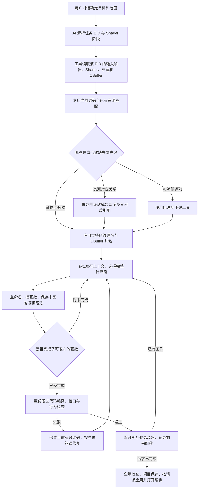

# Bread AI 工作流程与本次审查

这份说明区分“AI 决定做什么”和“程序检查这次操作能不能正确执行”。本次结论来自源码审查和回归测试，没有把某一场历史对话的耗时当成已经测量过的结果。

## 谁负责什么

| 角色 | 应当负责 | 不应当负责 |
| --- | --- | --- |
| 用户与对话 | 目标、范围、当前讨论的 EID、需要的最终结果 | 手工指定每个工具或修复步骤 |
| AI | 确定目标 EID，选择证据，判断资源对应关系，命名，划分函数，处理失败和继续工作 | 编造物理偏移、伪造成功、把小段完成说成整份完成 |
| Agent 运行器 | 调用模型、传递对话和工具结果、记录任务、识别空转 | 把界面起始 EID 永久锁定，替 AI 规定分析路线 |
| Skill | 提供方法和按需参考资料 | 以冗长固定脚本覆盖用户当前要求 |
| Host | 提供读写工具、执行事务、返回事实、校验目标和实际源码 | 用旧会话、命名进度、文档格式或审核次数指挥 AI 下一步 |
| RenderDoc Bridge 与编译器 | 读取真实捕获、执行名称修改、编译、接口检查、回放与恢复 | 决定哪个材质“更像”、应该如何理解算法 |

可以把 AI 理解成整理代码的人，Host 理解成带检查功能的工具箱。工具箱需要指出“这次编译失败”“这个偏移越界”，不能因为笔记没写完就禁止保存已经验证过的代码。

## 一次任务如何走

这是常见路径，不是 Host 强制状态机。例如，需要源码才能判断某个 CBuffer 成员时，可以先取得源码；某个资源仍然匹配不明时，可以保留中性名称并继续其他函数。

目标优先级是：最新明确对话 → 对话已确定的目标 → 明确触发的界面操作 → 界面当前选择。界面停在 EID 100，而对话要求处理 EID 200 时，读取和整理都应针对 200。工具仍然检查 200 实际绑定的对象，不能把 100 的验证记录搬过去。

## “保存了”其实有四种状态

| 状态 | 实际含义 |
| --- | --- |
| 工作草稿 | 修改已经保存，但仍在整理 |
| 编译通过的预览 | 草稿能编译，主编辑器当前源码没有因此改变 |
| 已晋升的当前源码 | 整份候选通过必要检查，新的代码成为后续工作的起点 |
| 已应用到回放 | 当前候选已经替换真实回放中的 Shader；这是独立副作用 |

过去容易把“预览能看见”误认为“主源码已经更新”。分块需要持久成果时，应进行函数范围审核；审核对象仍是完整候选代码，成功后晋升这份候选。只整理了一个函数时，整份任务继续显示未完成。

约 100 行是阅读窗口，不是函数大小。假设第 90 行开始一段条件计算，第 120 行才结束：可以先整理前面已经闭合的计算，把这段条件及依赖记录到下一窗口，或者适当扩大当前窗口。不要在第 100 行机械切断。每轮保存已完成函数、名称映射、源码版本、未完尾段和下一个问题。

## 为什么还需要 shaderResourceId

`shaderResourceId` 像当前捕获中的门牌号：执行修改时要知道修改哪个对象，但跨捕获或重新打开时不适合作为永久身份。

已有可信资源匹配时，不需要仅因旧文件缺门牌号就重新搜索整个解包目录。持久名称依据原始 Shader 字节码、阶段、绑定槽和空间、布局保存；工具从当前目标取得实际门牌号。旧别名表缺 ID 时，从已验证的来源捕获目录按原字节码、阶段、入口唯一恢复，再走原有布局检查。

恢复不了时逐行报告并跳过。原文件保留，有效行继续使用；没有有效行也应返回“未注册及原因”，而不是抛错终止其他工作。明确指向错误对象、错误捕获或不兼容布局的条目仍不能直接应用。

Shader 身份和材质身份也要区分：同一个 Shader 可以被多个材质实例共用。复用程序源码不代表所有实例绑定了同一纹理或参数，所以只刷新实际变化的绑定证据。

## 打开 RDC 时恢复 Shader

恢复源码按原始 Shader 字节、阶段和入口定位项目成果，不要求旧 EID、旧 ResourceId 或界面当前选择相同。阶段和入口用于区分同一程序容器中的多个入口。旧 ABI／布局摘要不同或缺失时，精确原程序匹配的源码仍可找回；旧二进制不会因此取得复用资格。新的源码导入凭据绑定当前目标，实际运行前仍执行当前编译与接口检查。

已有工作区的源码若没有旧版项目导入凭据，可以由当前工作区验证过的源码哈希、项目源码哈希和当前目标身份确认，不需要重新反编译。记录损坏与整个来源目录丢失的迁移仍应单独诊断，不能把这些场景宣称为全部兼容。

2026-09-22 的 `6.rdc` 恢复记录显示三个原 Shader 全部匹配，其中两个应用成功；另一个在准备工作区时被“当前界面事件变化”误判为失败。准备流程现只保持捕获／会话／项目一致，并验证明确请求的 EID／阶段导出结果。浏览其他 EID 不再取消该恢复。

该修复的最终回归为 511 项通过、1 项跳过，另有 335 个子测试通过。修复包于 16:17 部署，四个运行程序的哈希与构建清单一致；确认旧 Host 退出后重新打开同一个 `6.rdc`，16:20 的实际自动恢复记录为：尝试 3 个、应用成功 3 个、失败 0 个、跳过 0 个，三个工作区全部启用编辑监听，无警告。

只重开界面不等于安装修复。16:14 的失败复测仍使用 15:32 部署的旧程序；后台同版本 Host 也可以在关闭界面后约 15 秒内被重新接入。部署前应正常关闭界面并等待旧 Host 退出，使用部署脚本替换运行文件并校验哈希，再重开捕获。

## 本次确认并修正的断点

| 原实现问题 | 后果 | 调整 |
| --- | --- | --- |
| 把工具记录数量增长当作进展 | 重复查询也能延长自动续办 | 比较实际状态和内容，过滤轮询时间，识别往复循环 |
| 工具目标绑定初始 UI Shader | 明确指定其他 EID 仍可能被旧身份拒绝 | 路由按对话选择，使用工具观察到的目标身份 |
| 后台审核从错误层级读取 accepted | 已晋升却返回未接受，引发重复处理 | 从真实 verdict 读取审核结果 |
| 全任务完成门槛阻断部分源码发布 | 小函数完成仍一直停在草稿 | 技术发布与整份完成分开记录 |
| 文档、启发式质量和次数作为硬门槛 | 反复补表、重审、要求用户批准继续 | 返回诊断，不阻断通过物理验证的源码 |
| 别名持久比较包含可变 ResourceId | 重新打开后旧名称无法复用 | 用稳定原程序及布局身份比较 |
| 占位 CBuffer 的 AI 别名被无条件隐藏 | 已命名字段下一轮仍读不到 | 在正确 Shader/绑定作用域中读取已发布名称 |
| 旧别名一行缺 ID 导致整表失败 | 好的名称也无法应用 | 唯一恢复或逐行跳过，返回恢复记录 |
| Shader Skill 约 1,400 行且存在冲突要求 | 上下文重复负担和执行方向冲突 | 约 200 行入口，详细规则按需读取 |

资源“找到了”和名称“应用了”是不同结果。现在流程明确分别检查纹理显示名、CBuffer 面板别名和源码标识符三条写入回执；一条失败不会假装另外两条也失败或全部成功。

## 验证边界

回归覆盖了非 UI EID、不同 Shader 身份、旧别名恢复和歧义、已发布名称回读、分段晋升、文档问题不阻断、审核回执复用、窗口尾段连续性、空转识别以及技能参考文件加载。

三组最终验证：核心 Host 577 项通过；Agent/技能/工具代理 257 项通过、2 项跳过；补充 Host 集成 185 项通过、1 项跳过。合计 1,019 项通过，另有 174 个子测试通过。`git diff --check` 通过。测试使用操作系统临时目录，未改动实际项目资产。

编译成功只证明能编译；ABI 检查证明所检查的接口兼容；回放对比只证明当前捕获输入和指定容差下的输出。它们都不能证明恢复了历史原始源码或对所有输入完全等价。

本轮是源码和测试修正。运行中的旧进程不会因为源码文件被修改而自动替换实现；打包部署与真实捕获端到端运行的结果应另外报告。
